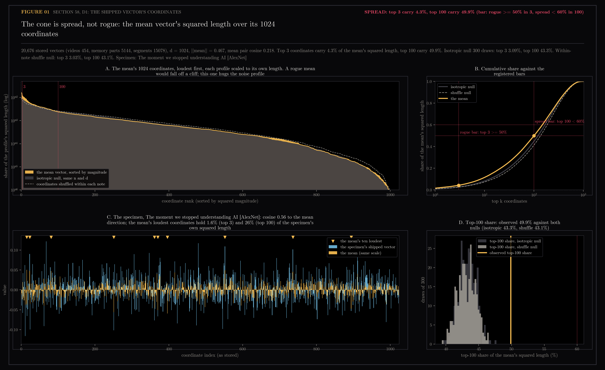
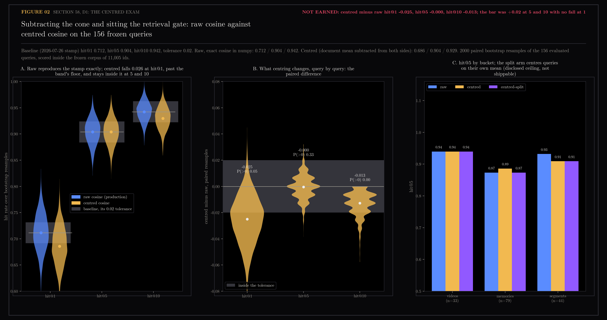

# 58 — D1: the shipped vector's coordinates, and the centred exam

First of the three encoder dissections registered in
`docs/design/encoder-anatomy/README.md` (the frog, its organs, the
predictions, nulls and bars, all written before this ran). The organism is
`Qwen/Qwen3-Embedding-0.6B` at the pinned revision, the production text
encoder since the v2 epoch (2026-07-17). The specimen is the Welch Labs note
"The moment we stopped understanding AI [AlexNet]", held since section 42.

Two questions. Section 12 found the cone: every note leans in one shared
direction, the mean vector has length 0.51, and a random pair's cosine is
0.26 where chance is near zero. Nobody had looked at the *shape* of that mean.
Timkey and van Schijndel (EMNLP 2021) found one to three "rogue" coordinates
carrying similarity in BERT and GPT-2; Sun et al. (COLM 2024) found at most
four "massive activations" per hidden state in LLaMA-2. So: is the cone a few
loud coordinates, or spread over many? And the question section 19 left open
and handed to the gate: does subtracting the mean help search?

Generated by `scripts/encoder_anatomy_d1.py`. Read-only on Chroma and the
vault. The harvest (every stored document vector, 20,676 x 1024) lives at
`~/.ytk/encoder-anatomy/d1-store.npz`, outside the repo; `coords.npz` and
`exam.npz` here hold what the figures need.

```bash
uv run --extra lab python scripts/encoder_anatomy_d1.py harvest   # 13 s
uv run --extra lab python scripts/encoder_anatomy_d1.py coords    # 78 s, two nulls of 300 draws
uv run --extra lab python scripts/encoder_anatomy_d1.py exam      # 26 s of query embedding, then numpy
uv run --extra lab python scripts/encoder_anatomy_d1.py figures
```

## 58.1 — The coordinates: spread, and nearly as flat as noise



The population is every stored document vector in the three text collections
(454 videos, 5,144 memory parts, 15,078 transcript segments), unit length as
Chroma compares them. The mean vector has length 0.467 and the mean pairwise
cosine is 0.218 (section 12 measured 0.51 and 0.259 on the 811 tagged notes;
the segments pull both down a little, and the three collections' means point
in related but not identical directions: videos to segments cosine 0.92,
videos to memories 0.78, memories to segments 0.76).

Registered prediction: spread, top 3 coordinates under 10% of the mean's
squared length, top 100 under 60%. Registered bar: rogue at top 3 >= 50%,
spread at top 100 < 60%.

| share of the mean's squared length | observed | isotropic null | within-note shuffle null |
|---|---|---|---|
| top 1 | 1.6% | 1.19 ± 0.24% | 1.16 ± 0.23% |
| top 3 | 4.3% | 3.09 ± 0.40% | 3.03 ± 0.41% |
| top 10 | 11.5% | 8.25 ± 0.67% | 8.15 ± 0.70% |
| top 100 | 49.9% | 43.3 ± 1.3% | 43.1 ± 1.4% |

**Spread, by the bar, and the prediction holds.** The surprise is how close
the mean's profile sits to a random mean's profile. Panel A draws each
profile scaled to its own length, because the isotropic mean is 70 times
shorter (length 0.007) and the raw magnitudes cannot share an axis; on that
footing the mean hugs the noise curve the whole way down. A rogue mean would
fall off a cliff after a few bars. This one is a cone whose direction is
written across hundreds of coordinates, each a little louder than noise
would make it (top 100 at 49.9% against 43.3%, about five null standard
deviations, so the direction is real and not flat; just not concentrated).

Timkey and van Schijndel's own ruler, the per-coordinate contribution to the
mean pairwise cosine, gives the same shares to three decimals and the same
ten loudest coordinates (396, 251, 370, 15, 552, 23, 894, 81, 361, 736), so
"the coordinates that carry the mean" and "the coordinates that carry the
similarity" are the same set here. On each of those ten, 91% to 98% of all
20,676 vectors agree in sign with the mean: the lean is unanimous, just not
loud.

The specimen sits at cosine 0.56 to the mean direction, a typical member of
the cone. The mean's top 3 coordinates hold 1.6% of its own squared length
and the top 100 hold 26%; its own ten loudest coordinates (68, 480, 11, 552,
251, 736, ...) share three with the mean's. Zeroing a few coordinates would
not remove the cone from it, which closes the "if rogue, the orb can paint
them" branch of the registration.

## 58.2 — The exam: centring is not earned, and it costs hit@1



The gate's 156 frozen known-item queries were embedded once through the
production query path (instruction prefix, 26 s) and scored in numpy with
exact cosine over all 20,676 vectors, memory parts collapsed to their best
part and videos and memories merged by score as `search_all` does, segments
ranked alone, then filtered to the 11,005 frozen ids and cut to ten, through
`retrieval_gate.evaluate` itself. The raw arm reproduces the 2026-07-26 stamp
to the third decimal (hit@1 0.712, hit@5 0.904, hit@10 0.942), which is both
the calibration of the numpy twin and a small note on the live gate: the
live run earlier today scored 0.897 / 0.936 through Chroma's approximate
index with over-fetch, so about half a point of the live gate's deficit
against its stamp is the index, not the ranking.

Centring subtracts the document mean from every document and from every
query, then renormalises.

| arm | hit@1 | hit@5 | hit@10 |
|---|---|---|---|
| baseline stamp, tolerance 0.02 | 0.712 | 0.904 | 0.942 |
| raw cosine (production) | 0.712 | 0.904 | 0.942 |
| centred, document mean both sides | 0.686 | 0.904 | 0.929 |
| centred-split, queries on their own mean (disclosed ceiling) | 0.692 | 0.897 | 0.929 |

Paired bootstrap over 2,000 resamples of the 156 queries, centred minus raw:
hit@1 -0.025 [-0.064, +0.006], hit@5 -0.000 [-0.019, +0.019], hit@10 -0.013
[-0.032, +0.000]. The registered bar for the search slot was hit@5 and
hit@10 both above the baseline by more than 0.02 with no fall at hit@1.
**Not earned.** The registered prediction was "inside the noise" at hit@5
and hit@10, and that held; hit@1 was not predicted and moved more than the
tolerance, downward, with the interval touching zero. By bucket, centring
lifts the videos' hit@1 (0.85 to 0.88) and the memories' hit@5 (0.87 to
0.89) while losing the memories' hit@1 (0.63 to 0.58) and the segments at
every k. The split arm, which centres queries on their own mean (the exam's
own 156 queries, so a ceiling and not a shippable path), does no better.

Section 19 measured centring at +1.2 points on tag agreement among
neighbours, a different ruler, and sent the question to the gate. The gate's
answer: the cone is spread across the coordinates, it is removable by one
subtraction, and removing it does not help the one task the search path is
scored on. Production stays raw cosine. The centring thread, open since
section 12, closes here.

## What D2 inherits

The cone's direction is spread, so the growth film (D2) should expect the
mean's length to rise across depth as a single direction accumulating
everywhere, not a few coordinates lighting up. The loudest coordinates and
the full mean are in `coords.npz` for the per-layer comparison. The specimen's
cosine to the mean, 0.56, is its badge going in.

## Files

- `01-the-coordinates.png` — the mean's sorted profile against both nulls, the cumulative share against the bars, the specimen's coordinates, the top-100 null distributions
- `02-the-exam.png` — bootstrap hit rates raw and centred with the baseline's band, the paired differences, hit@5 by bucket for all three arms
- `results.json` — every number above, nulls as mean and standard deviation, per-bucket rates, bootstrap intervals
- `coords.npz` — the mean, the specimen, one sorted draw of each null, the 300 top-3 and top-100 null shares
- `exam.npz` — the 2,000 bootstrap hit rates per arm and k, the per-query ranks per arm
