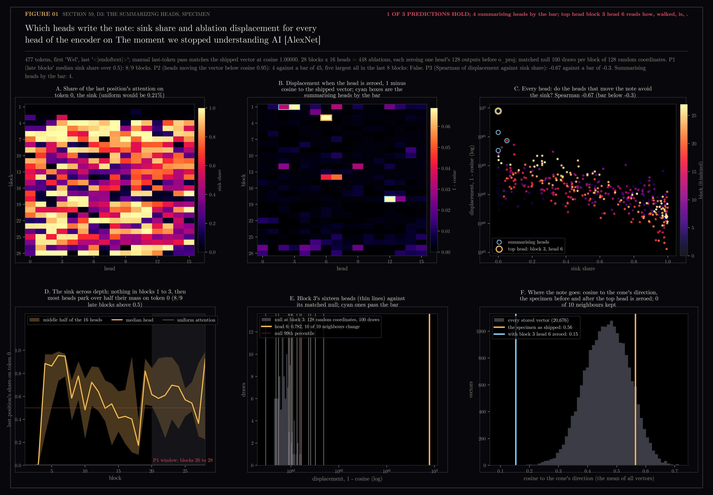

# 59 — D3: the summarizing heads, specimen run

Third of the encoder dissections registered in
`docs/design/encoder-anatomy/README.md`, run on the specimen alone (the
population run, 20 notes, is a separate go). The organism is
`Qwen/Qwen3-Embedding-0.6B` at the pinned revision; the specimen is the
Welch Labs note "The moment we stopped understanding AI [AlexNet]", 2,086
characters, 477 tokens, the last of them `<|endoftext|>`, which is the one
position the pooling keeps.

The question: with last-token pooling one position carries the note. Which
heads fill it, how much of each head's attention goes to the sink at
position 0 (Xiao et al., ICLR 2024), and how far does the note move when one
head is switched off?

Generated by `scripts/encoder_anatomy_d3.py`. Read-only on Chroma and the
vault; neighbours come from section 58's harvest. The attention pass uses
`attn_implementation="eager"`, which returns the weights; the vector it
produces matches the shipped one at cosine 1.00000, so the dissection is of
the production object and not a stand-in.

```bash
uv run --extra lab python scripts/encoder_anatomy_d3.py specimen   # 51 min, see the cost note
uv run --extra lab python scripts/encoder_anatomy_d3.py figures
```

**Cost note.** The registration estimated 5 minutes for 448 single-head
passes. Ablations were batched sixteen to a pass so the registered null (100
draws per block, 2,800 passes) would fit, but on Metal a batch of sixteen
costs sixteen times a single pass (16.3 s against 0.85 s), so the run took 7
minutes of ablation and 43 of null, 51 in all. The script printed the
estimate after the first block and did not stop; it should have, and the
population run will carry an abort above its budget.

## 59.1 — The figure



**Panel A, the sink.** In blocks 1 to 3 no head of the last position looks
at token 0 at all (share 0.000, where uniform attention would give 0.2%).
From block 4 on, most heads park over half their mass there, and the median
head stays above 0.5 through the top of the network except in block 27
(0.36). Prediction 1 said the median head in blocks 20 to 28 would be above
0.5: 8 of 9 blocks, so by the letter it fails on block 27 and by the shape it
is exactly the sink Xiao et al. describe.

**Panel B, the ablation.** Zeroing one head's 128 outputs before `o_proj`
and re-pooling. 444 of the 448 heads move the vector by less than 1 minus
cosine 0.05, the late blocks by far less: across blocks 21 to 28 the median
displacement is 0.001 and the largest is 0.022. Only four heads cross the
registered bar (at least 3 of the 10 nearest neighbours change, and the
displacement exceeds the block's matched null at its 99th percentile):

| block | head | cosine after | sink share | neighbours changed | reads from |
|---|---|---|---|---|---|
| 3 | 6 | 0.218 | 0.00 | 10 of 10 | how, walked, is |
| 1 | 3 | 0.858 | 0.00 | 6 of 10 | ., -, until |
| 18 | 12 | 0.926 | 0.05 | 3 of 10 | paragraph break, opaque, ability |
| 1 | 2 | 0.966 | 0.00 | 3 of 10 | ., compute, of |

Prediction 2 said fewer than 45 heads would move the vector below cosine
0.95 (4 did; holds) and that the five largest movers would all sit in the
last eight blocks (they sit in blocks 3, 1, 18, 14 and 14; fails). The
summary is not written by the top. The heads that matter most to where
this note lands are in the first three blocks, before the sink exists.

**Panel C, sink against displacement.** Across all 448 heads the Spearman
correlation between displacement and sink share is -0.67 against a bar of
-0.3. Prediction 3 holds, and strongly: the heads that move the note are the
ones that read the words, and the heads that stare at token 0 are the ones
whose removal changes nothing.

**Panels E and F, the head that holds the cone.** Block 3 head 6 is the
specimen's most consequential head by a factor of five. With it zeroed the
shipped vector is at cosine 0.22 to itself, every one of its ten neighbours
changes, and the new neighbours are no longer the interpretability notes it
lived among (the logit-lens article, the scaling-hypothesis article, Karpathy
and 3Blue1Brown videos) but session briefs and the interest profile. Panel F
says why: the ablated vector sits at cosine 0.15 to the cone's direction,
section 58's mean of all 20,676 vectors, where almost no stored vector lives
(the corpus runs from 0.2 to 0.7). The head does not push the note into the
cone's centre. It is part of what puts the note in the cone at all; without
it the note lands outside the population, and its nearest neighbours are
whatever happens to sit at the cone's thin edge. That this head lives in
block 3, the block before the sink appears in block 4, is the pattern Sun et
al. (COLM 2024) describe for massive activations: born in an early layer,
acting as a fixed bias from then on. Whether head 6 of block 3 is the head
that writes the sink itself, and whether it is the same head on every note,
is the population run's question.

## 59.2 — Verdict against the registration

| prediction | registered | measured | holds |
|---|---|---|---|
| 1, late blocks' median head on the sink above 0.5 | blocks 20 to 28 | 8 of 9 blocks; block 27 at 0.36 | no, by one block |
| 2a, heads moving the vector below cosine 0.95 | fewer than 45 | 4 | yes |
| 2b, five largest movers | all in the last 8 blocks | blocks 3, 1, 18, 14, 14 | no |
| 3, Spearman of displacement against sink share | below -0.3 | -0.67 | yes |

One of three predictions holds as written. The failures are the finding:
the encoder's late heads are nearly all sink-watchers whose individual
removal does not move the note, and the heads that decide where a note lands
are early, read content words, and one of them carries the cone. The
specimen's hidden states at every layer (last token, raw and through the
final norm) are in `specimen.npz` for D2's thread.

## Files

- `01-the-heads.png` — sink grid, displacement grid with the four summarising heads boxed, sink against displacement for every head, the sink across depth with the uniform null, block 3's heads inside its matched null, the specimen's cosine to the cone before and after the top head is zeroed
- `results.json` — predictions and bars, the four summarising heads, the top head's words and neighbours before and after, timings
- `specimen.npz` — sink and self shares (28 x 16), displacement and neighbours-changed grids, the null (28 x 100), top attended positions per head, the tokens, the shipped and top-ablated vectors, last-token hidden states at all 29 depths raw and normed
