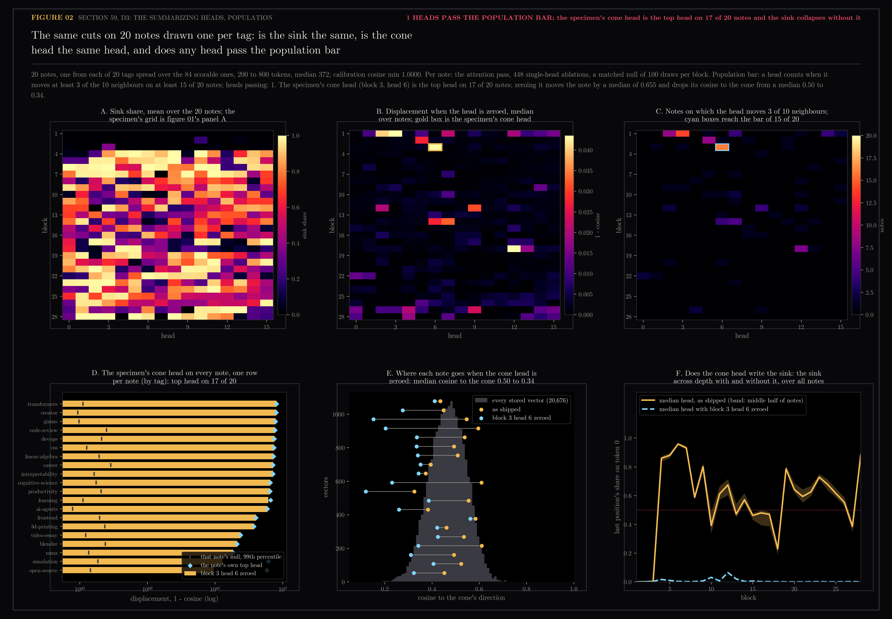
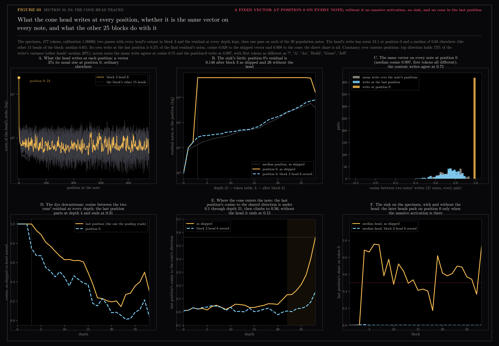

# 59 — D3: the summarizing heads, specimen run

Third of the encoder dissections registered in
`docs/design/encoder-anatomy/README.md`, run on the specimen alone (the
population run, 20 notes, was a separate go and is 59.3). The organism is
`Qwen/Qwen3-Embedding-0.6B` at the pinned revision; the specimen is the
Welch Labs note "The moment we stopped understanding AI [AlexNet]", 2,086
characters, 477 tokens, the last of them `<|endoftext|>`, which is the one
position the pooling keeps.

The question: with last-token pooling one position carries the note. Which
heads fill it, how much of each head's attention goes to the sink at
position 0 (Xiao et al., ICLR 2024), and how far does the note move when one
head is switched off?

Generated by `scripts/encoder_anatomy_d3.py`. Read-only on Chroma and the
vault; neighbours come from section 58's harvest. The attention pass uses
`attn_implementation="eager"`, which returns the weights; the vector it
produces matches the shipped one at cosine 1.00000, so the dissection is of
the production object and not a stand-in.

```bash
uv run --extra lab python scripts/encoder_anatomy_d3.py specimen   # 51 min, see the cost note
uv run --extra lab python scripts/encoder_anatomy_d3.py figures
uv run --extra lab python scripts/encoder_anatomy_d3.py population  # 885 min, 20 notes, resumable; 59.3
uv run --extra lab python scripts/encoder_anatomy_d3.py population_figures
HF_HUB_OFFLINE=1 uv run --extra lab python scripts/encoder_anatomy_d3.py trace  # 23 s, 2 + 20 passes; 59.4
uv run --extra lab python scripts/encoder_anatomy_d3.py trace_figure
```

**Cost note.** The registration estimated 5 minutes for 448 single-head
passes. Ablations were batched sixteen to a pass so the registered null (100
draws per block, 2,800 passes) would fit, but on Metal a batch of sixteen
costs sixteen times a single pass (16.3 s against 0.85 s), so the run took 7
minutes of ablation and 43 of null, 51 in all. The script printed the
estimate after the first block and did not stop; it should have, and the
population run will carry an abort above its budget.

## 59.1 — The figure


**Panel A, the sink.** In blocks 1 to 3 no head of the last position looks
at token 0 at all (share 0.000, where uniform attention would give 0.2%).
From block 4 on, most heads park over half their mass there, and the median
head stays above 0.5 through the top of the network except in block 27
(0.36). Prediction 1 said the median head in blocks 20 to 28 would be above
0.5: 8 of 9 blocks, so by the letter it fails on block 27 and by the shape it
is exactly the sink Xiao et al. describe.

**Panel B, the ablation.** Zeroing one head's 128 outputs before `o_proj`
and re-pooling. 444 of the 448 heads move the vector by less than 1 minus
cosine 0.05, the late blocks by far less: across blocks 21 to 28 the median
displacement is 0.001 and the largest is 0.022. Only four heads cross the
registered bar (at least 3 of the 10 nearest neighbours change, and the
displacement exceeds the block's matched null at its 99th percentile):

| block | head | cosine after | sink share | neighbours changed | reads from |
|---|---|---|---|---|---|
| 3 | 6 | 0.218 | 0.00 | 10 of 10 | how, walked, is |
| 1 | 3 | 0.858 | 0.00 | 6 of 10 | ., -, until |
| 18 | 12 | 0.926 | 0.05 | 3 of 10 | paragraph break, opaque, ability |
| 1 | 2 | 0.966 | 0.00 | 3 of 10 | ., compute, of |

Prediction 2 said fewer than 45 heads would move the vector below cosine
0.95 (4 did; holds) and that the five largest movers would all sit in the
last eight blocks (they sit in blocks 3, 1, 18, 14 and 14; fails). The
summary is not written by the top. The heads that matter most to where
this note lands are in the first three blocks, before the sink exists.

**Panel C, sink against displacement.** Across all 448 heads the Spearman
correlation between displacement and sink share is -0.67 against a bar of
-0.3. Prediction 3 holds, and strongly: the heads that move the note are the
ones that read the words, and the heads that stare at token 0 are the ones
whose removal changes nothing.

**Panels E and F, the head that holds the cone.** Block 3 head 6 is the
specimen's most consequential head by a factor of five. With it zeroed the
shipped vector is at cosine 0.22 to itself, every one of its ten neighbours
changes, and the new neighbours are no longer the interpretability notes it
lived among (the logit-lens article, the scaling-hypothesis article, Karpathy
and 3Blue1Brown videos) but session briefs and the interest profile. Panel F
says why: the ablated vector sits at cosine 0.15 to the cone's direction,
section 58's mean of all 20,676 vectors, where almost no stored vector lives
(the corpus runs from 0.2 to 0.7). The head does not push the note into the
cone's centre. It is part of what puts the note in the cone at all; without
it the note lands outside the population, and its nearest neighbours are
whatever happens to sit at the cone's thin edge. That this head lives in
block 3, the block before the sink appears in block 4, is the pattern Sun et
al. (COLM 2024) describe for massive activations: born in an early layer,
acting as a fixed bias from then on. Whether head 6 of block 3 is the head
that writes the sink itself, and whether it is the same head on every note,
is the population run's question.

## 59.2 — Verdict against the registration

| prediction | registered | measured | holds |
|---|---|---|---|
| 1, late blocks' median head on the sink above 0.5 | blocks 20 to 28 | 8 of 9 blocks; block 27 at 0.36 | no, by one block |
| 2a, heads moving the vector below cosine 0.95 | fewer than 45 | 4 | yes |
| 2b, five largest movers | all in the last 8 blocks | blocks 3, 1, 18, 14, 14 | no |
| 3, Spearman of displacement against sink share | below -0.3 | -0.67 | yes |

One of three predictions holds as written. The failures are the finding:
the encoder's late heads are nearly all sink-watchers whose individual
removal does not move the note, and the heads that decide where a note lands
are early, read content words, and one of them carries the cone. The
specimen's hidden states at every layer (last token, raw and through the
final norm) are in `specimen.npz` for D2's thread.

## 59.3 — The population: twenty notes, one per tag



Twenty notes drawn one per tag, the tags spread evenly over the 84 scorable
ones, 200 to 800 tokens (median 372), each given the specimen's whole
treatment: the attention pass, 448 single-head ablations, the registered
null of 100 draws per block, and one more pass with block 3 head 6 zeroed
and the attention weights kept. Every note's attention-pass vector matches
its shipped vector at cosine 1.0000. The run took 885 minutes, 20 notes at
24 to 95 minutes each by length. The cost note above promised an abort
above budget; it was not added, because the go for this run was given with
the full registered null and the 15-hour figure in hand, and the script
checkpoints after every note so a stop loses at most one.

**The same head, on 17 of 20 notes.** Block 3 head 6 is the top head on 17
notes. The exceptions are the Witch Hat Atelier spell simulator and the
gravity-algorithm video, where block 1 head 3 leads and the cone head moves
the note by only 0.10 and 0.13, and the Instagram learning note, where block
2 head 5 leads at 0.661 with the cone head at 0.617 just behind. Zeroing the
cone head moves a note by a median of 0.655 (cosine 0.345 to itself), range
0.096 to 0.811, and on all 20 notes the move is above that note's own null
at block 3 (99th percentile).

**It passes the population bar, and it is the only head that does.** The
registered bar was 3 of the 10 nearest neighbours changed on at least 15 of
the 20 notes. Block 3 head 6 changes 3 or more on 16. The runner-up is block
1 head 3 on 14, one short, and no other head reaches 10 (panel C). The
specimen's four summarising heads are also the population's four most
frequent top-five movers: block 3 head 6 and block 1 head 3 are in every
note's top five, block 18 head 12 in 17 of 20, block 1 head 2 in 11. The
late blocks stay inert on every note: across blocks 21 to 28 the median
displacement is 0.001 and the largest 0.060. Between 2 and 6 heads per note
move the vector below cosine 0.95, against the registered bar of 45, and the
rank correlation of displacement against sink share runs from -0.62 to
-0.70 per note, median -0.66. Section 59.1's three verdicts hold on every
note in the sample.

**The cone, population-wide.** With the head zeroed the median cosine to
the shared direction falls from 0.50 to 0.34 (after: 0.12 to 0.56). Panel E
draws each note against the corpus histogram: 17 of them move left toward
the histogram's thin edge, and the three exceptions barely move. The
specimen's own fall to 0.15 was the extreme of the range, not the typical
case; the typical note is pushed to the edge of the population, not out of
it.

**It builds the sink.** With block 3 head 6 zeroed and the attention weights
kept, the last position's share on token 0 across blocks 4 to 28, median
head, falls from 0.64 to 0.007. As shipped, 18 of those 25 blocks have a
median head above 0.5; with the head zeroed, none does (panel F, the dashed
line on the floor). Per note, the sink drops below 0.1 on 12 of 20 and
survives in part (0.23 to 0.59) on 8, and those 8 are the notes where the
cone head moves the note least: the rank correlation between how much the
head moves a note and how much sink survives its removal is -0.66. On the
notes where another head leads, that head presumably builds the sink
instead, which this run did not measure. The question section 59.1 handed
to the population was whether the head that carries the cone also writes
the sink. It does. The cone and the sink are one mechanism: something
written in block 3, which every later head parks on from block 4, and
without which the note lands at the edge of the population. Whether the head
writes it at position 0 alone or at every position, and whether the base
Qwen3-0.6B already has this head doing this job before the contrastive
tuning, are the next questions and are not in this record.

| bar | registered | measured | holds |
|---|---|---|---|
| a head is real when it moves 3 of 10 neighbours on 15 of 20 notes | at least one | block 3 head 6 on 16 of 20; no other head | yes |
| the same top head across notes | open question | 17 of 20 | |
| the cone head writes the sink | open question | blocks 4 to 28 median share 0.64 to 0.007 | |

## 59.4 — The cone head traced through the whole pass



The owner's question after 59.3 was whether the head could be watched
rather than only removed. It can, cheaply: two passes on the specimen with
every head's output in block 3 and the raw residual at every depth kept,
with and without the head, then one pass on each of the 20 population
notes. 23 seconds. The head fires once, in block 3, and writes a vector
into the residual at every position; everything after is the other 25
blocks reading what it wrote, so the trace follows that one write
downstream the way dye is followed down a river.

**At position 0 it writes one fixed vector.** The head's write has norm
24.1 at position 0 and a median of 0.65 at every other position, the same
as the block's other fifteen heads (median 0.65; at position 0 they write
1.3 to 2.5, one of them 7.8). Across the 20 population notes plus the
specimen the position-0 write is the same vector, median cosine 0.997
between any two notes, although the first tokens differ ("Wel", "!",
"Jeff", "Grant", "Web", "Build"). It is a register in the sense of the
Welch Labs short on vision transformers: a slot that holds the same thing
for every input, parked on the first token because the model has no spare
one. At the content positions the write is not a stamp: between notes the
mean write agrees at cosine 0.75 and the last-position write at 0.75, and
within the specimen the top direction holds 73% of the write's variance,
more than the other heads' 29% but far from one vector.

**Block 3's feed-forward turns it into the massive activation.** Position
0's residual norm is 17 entering block 3 and 6,146 leaving it, against a
median position's 13 (panel B). Without the head it is 26. The block's
attention adds at most the sixteen heads' writes, under 50 by norm, so the
remaining six thousand come from the block's feed-forward, which fires on
the head's write and not without it. This is the massive activation of Sun
et al. (COLM 2024), born in an early layer and fixed from then on: the norm
stays between 6,120 and 6,170 through block 26, is 5,892 after block 27
and 1,581 after block 28, and the final norm flattens it. On the
specimen the sink follows it exactly: the median head's share on token 0
is 0.89 at block 4 as shipped and 0.01 without the head, at every block
(panel F).

**The direct share is nil.** The head's own write at the last position is
0.2% of the final residual's norm, at cosine 0.028 to the shipped vector
and 0.008 to the cone's direction. Nothing the head writes reaches the
shipped vector directly; everything it does, it does through position 0.
Both of 59.3's open framings are settled: it is not the direct writer of
the cone, it is the keystone.

**The cone enters the note in the last seven blocks.** Panel E is the
finding the trace adds. As shipped, the last position's cosine to the
shared direction stays at or under 0.06 from the token table through depth
21, then climbs 0.13, 0.13, 0.16, 0.21, 0.28, 0.40, 0.56 at depths 22 to
28. Without the head it stays under 0.08 through depth 27 and ends at 0.15.
The cone is not carried up from block 3; it is deposited into the last
position late, by the heads that park on position 0 and copy what sits
there, which is the same window in which rung B's search climbs (section
60.2, hit@1 from 25% at depth 21 to 71% at 28) and the same heads 59.1
found inert one at a time. Individually dispensable, together they write
the shared direction. Rung A's finding that notes grow less alike with
depth (mean length 0.94 at depth 16, 0.51 at 28) is the same data read
differently: early states are alike along the end-of-text token's own
direction, which is not the cone's; that likeness is spent as content
arrives, and the cone's direction is added at the end.

**The dye.** The two runs' last-position states part at depth 4 (cosine
0.93), drift to 0.14 at depth 22, and end at 0.31 (panel D). Position 0
parts at once (0.75 at depth 4) and ends at 0.05. So the note with the
head zeroed is not the shipped note minus its cone; it is a different
note, at cosine 0.31 to itself, because every later head lost its parking
spot and read the words instead, which is Barbero et al.'s over-mixing
account measured on one specimen.

**What this decides.** The gate run proposed after 59.3, the frozen corpus
with this head zeroed, would measure an encoder with no sink, which the
dye says is a different animal rather than a de-coned one. It would answer
whether the sink is load-bearing for retrieval (almost certainly, at
cosine 0.31 to itself) and not whether the cone is. The sharper cut is to
split the head's write by position: zero it at position 0 only, which
removes the register and the sink while leaving the content writes, and
zero it at content positions only, which does the reverse. Two passes on
the specimen each, then the neighbours. That is the next registration,
not this record.

| question from 59.3 | measured |
|---|---|
| does the head write a constant vector | at position 0, yes: cosine 0.997 across 21 notes, 37x its usual norm; at content positions, no: 0.75 across notes |
| at position 0 alone, or everywhere | everywhere, but only the position-0 write is large and fixed |
| direct writer or keystone | keystone: direct share 0.2% of norm, cosine 0.028 to the shipped vector; the cone enters the last position at depths 22 to 28 through heads reading position 0 |
| does the base Qwen3-0.6B already carry it | not measured |

## Files

- `01-the-heads.png` — sink grid, displacement grid with the four summarising heads boxed, sink against displacement for every head, the sink across depth with the uniform null, block 3's heads inside its matched null, the specimen's cosine to the cone before and after the top head is zeroed
- `results.json` — predictions and bars, the four summarising heads, the top head's words and neighbours before and after, timings
- `specimen.npz` — sink and self shares (28 x 16), displacement and neighbours-changed grids, the null (28 x 100), top attended positions per head, the tokens, the shipped and top-ablated vectors, last-token hidden states at all 29 depths raw and normed
- `02-the-population.png` — the sink and displacement grids over 20 notes, the heads reaching the population bar, the cone head on every note against its null, each note's cosine to the cone before and after on the corpus histogram, the sink across depth with and without the cone head
- `population.json` — per note: key, tag, tokens, calibration, top head and its displacement, the cone head's displacement and neighbours changed, cosine to the cone before and after, neighbours before, seconds
- `population.npz` — per note: sink grid, displacement grid, neighbours-changed grid, the null's 99th percentile per block, the sink grid with the cone head zeroed, the shipped and cone-head-ablated vectors
- `results.json` also carries a `population` block: the bar, the heads passing it, the cone head's statistics, the top-five movers' counts, the late blocks, per-note movers and correlations, and the sink before and after
- `03-the-trace.png` — the head's write at every position against its block, position 0's residual norm by depth with and without the head, the write's agreement across notes at position 0 and at content positions, the two runs' cosine by depth, the last position's cosine to the cone by depth, the sink by block
- `trace.npz` — per head of block 3: write norm and cosine to the head's mean write at every position, top singular fraction, cosine of the write to the cone; the cone head's writes (477 x 1024, half precision); the direct-share statistics; the two runs' cosines by depth; cosine to the cone by depth; residual norms at every depth and position for both runs; sink grids for both runs; the population notes' unit mean, last and position-0 writes, their top singular fractions and first tokens
- `results.json` also carries a `trace` block: the cone head's write statistics, the dye by depth, the massive activation by depth, the sink by block for both runs, and the population constancy
