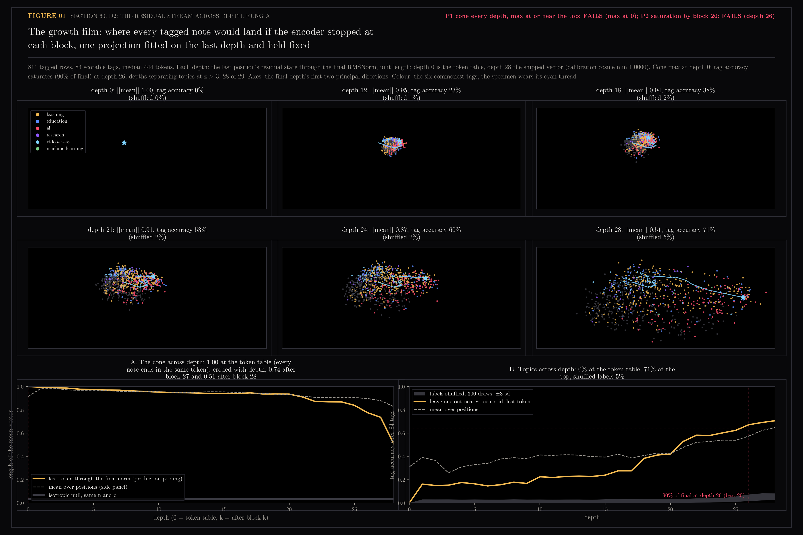
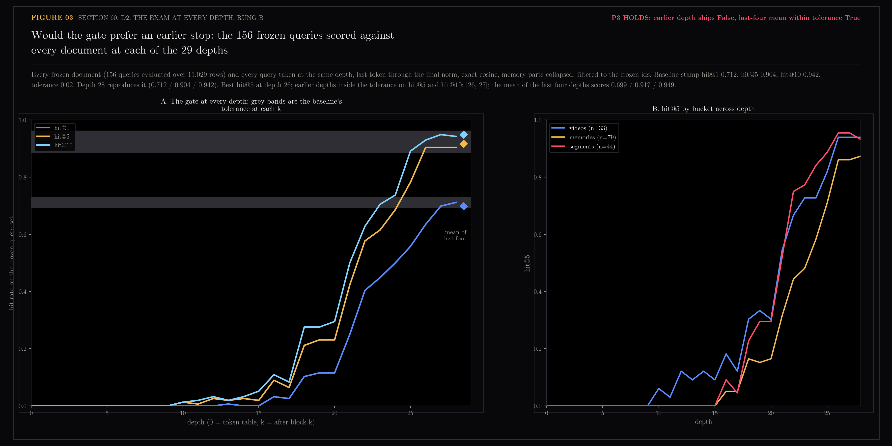

# 60 — D2: the residual stream across depth

Second of the encoder dissections registered in
`docs/design/encoder-anatomy/README.md`. Rung A runs the 811 tagged rows
(section 10's join of frontmatter tags to stored vectors) once each with
hidden states kept, and asks at every depth where the note would land if the
encoder stopped there. Rung B runs the gate's frozen corpus the same way and
sits the exam at every depth.

The per-depth vector is the last position's residual state through the
final RMSNorm, unit length, which is exactly what the production pooling
reads at depth 28. Depth 0 is the token table, depth k is after block k.
Mean-over-positions pooling is drawn as a dashed side line and never the
claim.

Generated by `scripts/encoder_anatomy_d2.py`. Read-only on Chroma and the
vault. The per-depth vectors (811 x 29 x 1024, 86 MB) live at
`~/.ytk/encoder-anatomy/d2-layers.npz`, outside the repo.

```bash
HF_HUB_OFFLINE=1 uv run --extra lab python scripts/encoder_anatomy_d2.py harvest    # 21 min, one pass per row
uv run --extra lab python scripts/encoder_anatomy_d2.py analyze                     # cone and tag accuracy per depth, nulls
uv run --extra lab python scripts/encoder_anatomy_d2.py figures                     # the contact sheet and the film
HF_HUB_OFFLINE=1 uv run --extra lab python scripts/encoder_anatomy_d2.py harvest_frozen  # rung B, 11,029 rows + 156 queries, 119 min
uv run --extra lab python scripts/encoder_anatomy_d2.py exam && ... exam_figure     # rung B, the gate at every depth
```

Two notes on the run. `HF_HUB_OFFLINE=1` is needed in an interactive shell:
a stored Hugging Face token this account no longer holds makes the hub's
HEAD request fail with 401, and the loader then refuses the cached snapshot
it already has. And the first harvest normed depth 28 twice, because the
last entry of Hugging Face's hidden states is already through the final
norm; the double norm is an elementwise scale by the norm's weight, so the
file was repaired in place by dividing it out, and the depth-28 vectors now
match the shipped ones at median cosine 1.00000, minimum 0.99996. The
harvest code carries the fix.

## 60.1 — Rung A: the note arrives late, and the top block does the most



The film (`02-the-growth-film.gif`, 29 frames) places every note by one
projection, the final depth's first two principal directions, held fixed, so
motion is the representation changing and never the projection.

**The cone is not born; it is eroded.** At the token table the mean vector
has length 1.00: every note's last position is the same end-of-text token,
so every note is the same point. Content flows into that position slowly.
The mean's length is still 0.94 after block 16 and 0.91 after block 21, then
falls to 0.74 after block 27 and 0.51 after block 28. The last block alone
removes as much of the shared direction as the previous twenty-seven
together. Prediction 1 said the cone would be present at every depth and
rise to a maximum at or near the top. Present at every depth, yes (the
isotropic null is 0.035); the maximum is at depth 0 and the direction of
travel is the opposite of the one registered. The contrastive tuning does
not sharpen the cone; what it leaves at 0.51 is the residue it could not
remove.

**Topics arrive late.** Leave-one-out nearest-centroid accuracy over the 84
scorable tags is 0% at the token table (one point), 16% after block 1 (the
first trickle of content into the last position is already topical: the
shuffled-label null is 1.4%), 23% at block 12, 28% at block 16, then 38% at
block 18, 53% at block 21, 60% at block 24, 71% at the top. Ninety percent
of the final accuracy is first reached at depth 26, against a registered bar
of 20. Prediction 2 fails. Every depth from 1 to 28 separates topics beyond
z = 3 (z runs from 24 to 97), so the bar for "separates topics" is met
everywhere; what moves is how well.

**Mean pooling is the earlier reader.** Averaging all positions instead of
reading the last one gives 31% at the token table and 41% through the middle
blocks, ahead of the last token until block 20, then falls behind: 65% at
the top against 71%. The last position catches up only in the final eight
blocks, which is where the summarizing happens (section 59 found the heads
that move the note in blocks 1 to 3 and 18; here the readout they feed
becomes topical from block 18 on). The residual stream's magnitude at the
last position grows from 1 at the token table to 739 after block 27, a
seven-hundred-fold climb that the final norm flattens.

| depth | mean length | tag accuracy | shuffled |
|---|---|---|---|
| 0 | 1.000 | 0% | 0% |
| 1 | 0.995 | 16% | 1.4% |
| 12 | 0.95 | 23% | 1.4% |
| 18 | 0.94 | 38% | 1.7% |
| 21 | 0.91 | 53% | 1.9% |
| 24 | 0.87 | 60% | 2.4% |
| 27 | 0.74 | 69% | 5.3% |
| 28 | 0.51 | 71% | 5.5% |

Both of rung A's predictions failed as written, in the same direction: the
registration imagined the encoder building a summary gradually across depth;
the encoder keeps the last position nearly empty for two thirds of its depth
and writes the note in the last third, with block 28 doing the largest single
share of the geometric work.

## 60.2 — Rung B: the exam at every depth



The frozen corpus (11,029 documents and the 156 queries, every one at all
29 depths, 119 minutes, 3.6 million tokens) scored through
`retrieval_gate.evaluate` with section 58's numpy twin of the production
searchers. Queries and documents are always taken at the same depth, so
each depth is a complete encoder stopped early, not a mismatch. Depth 28
reproduces the baseline stamp exactly (0.712 / 0.904 / 0.942), which is the
check that the harvest holds the shipped vectors.

**The gate is blind for half the network.** Every hit rate is zero through
depth 9. The first hit@5 at all is one video at depth 10; hit@1 stays at or
below 3% through depth 17. Then the climb: hit@1 goes 10% at depth 18, 25%
at 21, 40% at 22, 56% at 25, 70% at 27, 71% at 28. Block 21 alone adds 13
points of hit@1 and block 22 another 15. The three buckets climb in the
same window but not together: memory notes (79 queries) trail videos and
segments by about two blocks on hit@5 and are the last to reach the band,
which is the bucket where the gate's live deficit also sits.

**Prediction 3 holds.** No earlier depth ships: the best hit@5 before the
top is depth 26 at 0.904, equal to the stamp, but its hit@1 is 0.635, eight
points short. Depths 26 and 27 are inside the tolerance on hit@5 and hit@10
only. The mean of the last four depths scores 0.699 / 0.917 / 0.949, inside
the 0.02 band on all three; averaging the last four stops costs one point
of hit@1 and gains one of hit@5. The registered question was whether the
final block is load-bearing for the exam or just the last of several
near-equivalent stops; it is load-bearing for hit@1 and dispensable for
hit@5 and hit@10.

| depth | hit@1 | hit@5 | hit@10 |
|---|---|---|---|
| 9 | 0.000 | 0.000 | 0.000 |
| 17 | 0.026 | 0.064 | 0.083 |
| 18 | 0.103 | 0.212 | 0.276 |
| 21 | 0.250 | 0.423 | 0.500 |
| 24 | 0.500 | 0.686 | 0.737 |
| 26 | 0.635 | 0.904 | 0.929 |
| 27 | 0.699 | 0.904 | 0.949 |
| 28 | 0.712 | 0.904 | 0.942 |
| mean 25-28 | 0.699 | 0.917 | 0.949 |

Rung A measured topics arriving late; rung B measures the search arriving
later still. Tag accuracy was 38% at depth 18 while the exam's hit@1 was
10%, and 53% at depth 21 against 25%: knowing a note's topic is a coarser
thing than finding it from a known-item query, and the fine part is written
in the last seven blocks.

## 60.3 — Verdict against the registration

| prediction | registered | measured | holds |
|---|---|---|---|
| 1, cone present at every depth, maximum at or near the top | rising to the top | present everywhere; maximum 1.00 at depth 0, 0.51 at the top | no |
| 2, tag accuracy saturates by depth 20 | 90% of final by 20 | 90% of final first at depth 26 | no |
| 3, no earlier depth ships; last-four mean within tolerance | both | best earlier hit@1 0.635; mean 0.699 / 0.917 / 0.949 | yes |

One of three holds. The two that failed both imagined the encoder as a
gradual builder; it is a late one, and nothing before block 25 could
replace what ships.

## Files

- `01-the-growth.png` — six frames of the film, the cone across depth against the isotropic null, tag accuracy across depth against shuffled labels
- `02-the-growth-film.gif` — all 29 frames, the specimen's thread in cyan
- `03-the-exam-by-depth.png` — the three hit rates at every depth against the baseline's tolerance bands, the last-four mean as diamonds; hit@5 by bucket
- `results.json` — per-depth cone length, pair cosine, tag accuracy with the shuffled null's mean and sd and z, for both poolings; saturation and separating depths; the residual norm by depth; the exam at every depth with per-bucket scores, the last-four mean and the verdict
