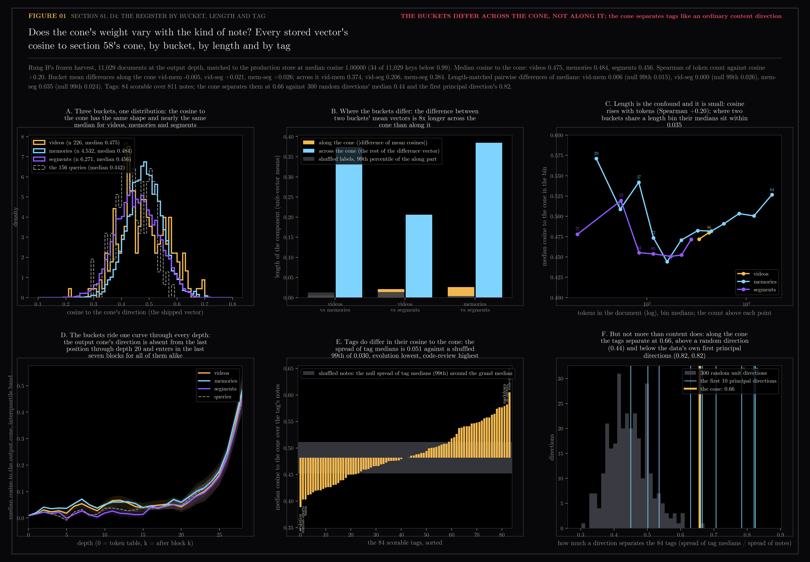
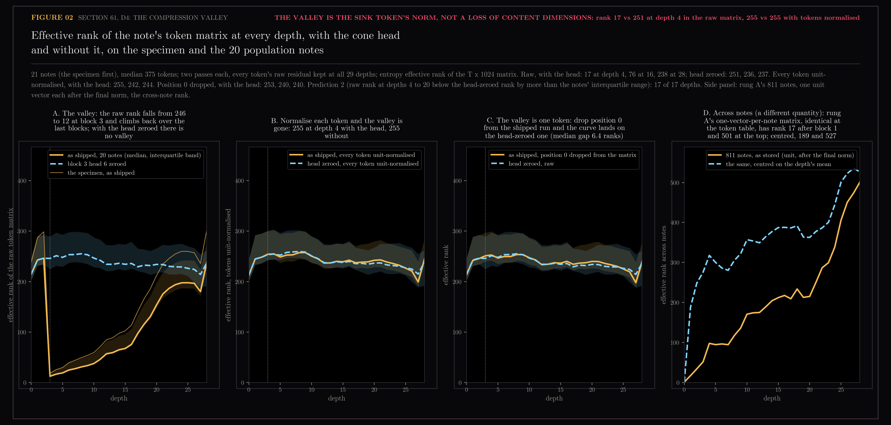
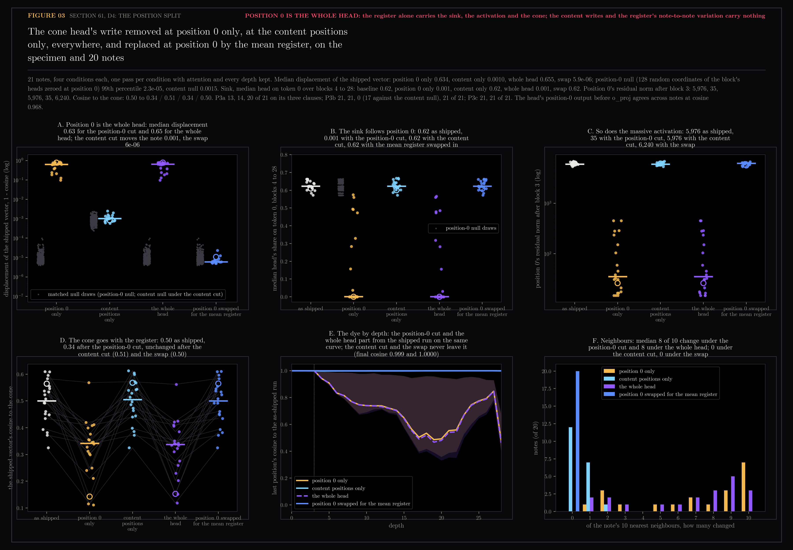

# 61 — D4: the register, label or bias

Fourth dissection of the encoder-anatomy program
(`docs/design/encoder-anatomy/README.md`), registered 2026-11-08 after the
literature pass that followed section 59.4 and run the same day. The
organism is `Qwen/Qwen3-Embedding-0.6B` at the pinned revision; the
specimen is the Welch Labs note "The moment we stopped understanding AI
[AlexNet]", 477 tokens; the population is the 20 notes of 59.3, fetched by
their stored keys so the set cannot drift with the store.

Where the program stood: block 3 head 6 writes one fixed vector at position
0 on every note (59.4, cosine 0.997 across 21 notes), block 3's feed-forward
turns it into the massive activation, every later head parks on it, and the
cone enters the last position in the last seven blocks through the heads
that read position 0. The question this section asks is what that register
is. Zhang, Khan and Papyan (NeurIPS 2025) describe sinks as a catch, tag,
release mechanism in which the shared direction is a label later tokens
retrieve, so the cone should vary with the kind of note. Queipo-de-Llano et
al. (2025) tie the massive activation to a compression valley in the middle
layers. Sun et al. (COLM 2024) replaced massive activations with their mean
and saw nothing change: a bias. Three readings, one per account.

Generated by `scripts/encoder_anatomy_d4.py`. Read-only on Chroma and the
vault; it reads section 58's cone, the D1 store harvest, rung A's and rung
B's depth harvests, and 59.3's population keys.

```bash
uv run --extra lab python scripts/encoder_anatomy_d4.py tag      # 16 s, no model; 61.1
uv run --extra lab python scripts/encoder_anatomy_d4.py tag_figure
HF_HUB_OFFLINE=1 uv run --extra lab python scripts/encoder_anatomy_d4.py valley   # 126 s, 42 passes; 61.2
uv run --extra lab python scripts/encoder_anatomy_d4.py valley_figure
HF_HUB_OFFLINE=1 uv run --extra lab python scripts/encoder_anatomy_d4.py split    # 6 min, 84 + 1,000 null passes; 61.3
uv run --extra lab python scripts/encoder_anatomy_d4.py split_figure
```

## 61.1 — The tag: does the cone's weight vary with the kind of note



**What was measured.** Every document in rung B's frozen harvest (11,029
documents at all 29 depths, with bucket and token count) and every vector in
the production store (20,676): the cosine to section 58's cone. The two
sources agree: 11,029 keys match at median cosine 1.00000, with 34 below
0.99 (documents re-embedded after an edit since the freeze). The output-depth
medians by bucket from the harvest and from the store:

| bucket | n (harvest) | median cosine, harvest | median cosine, store |
|---|---|---|---|
| videos | 226 | 0.475 | 0.479 |
| memories | 4,532 | 0.484 | 0.491 |
| segments | 6,271 | 0.456 | 0.458 |
| the 156 queries | 156 | 0.442 | |

**Length first.** Token count correlates with the cosine at Spearman +0.20
over all documents (+0.09 to +0.15 inside each bucket), and the buckets
barely overlap in length: segments run 96 to 384 tokens, memories 96 to
1,536, videos 192 to 768. Only one bin of the registered edges, 192 to 384
tokens, holds all three buckets with at least ten each; there the medians
are 0.465, 0.481 and 0.457, a spread of 0.024 against a within-bin shuffled
null whose 99th percentile is 0.023. By the letter the registered clause
passes; by the shape it is a hair above chance in one bin. Two buckets at a
time, in finer bins: videos against memories differ by 0.006 over two bins
(null 99th 0.015); videos against segments by 0.000 in the one bin they
share (null 0.026); memories against segments by 0.035 over seven bins (null
0.024), carried by the three bins under 96 tokens where the memory side has
29, 15 and 37 documents; from 128 tokens up the two sit within 0.018.

**The decisive cut.** The buckets' mean vectors do differ: pairwise cosine
0.767 (videos, memories), 0.916 (videos, segments), 0.742 (memories,
segments), against 0.981 for the smallest pair under shuffled labels. But
decompose each difference vector into its part along the cone and the rest:

| pair | length of the difference | along the cone | across the cone |
|---|---|---|---|
| videos, memories | 0.374 | -0.005 | 0.374 |
| videos, segments | 0.207 | +0.021 | 0.206 |
| memories, segments | 0.385 | +0.026 | 0.384 |

The buckets occupy different regions, which is content, and they carry the
cone at the same weight to within 0.03. Panel D says the same at every
depth: the output cone's direction is absent from the last position through
depth 20 for all four groups alike (median cosine under 0.07) and enters in
the last seven blocks for all of them together, the population-scale
version of 59.4's panel E.

**Tags.** Over rung A's 811 notes and 84 scorable tags, the per-tag median
cosine to the cone spreads with a standard deviation of 0.051 against a
shuffled-notes 99th percentile of 0.030 (z 11): evolution sits lowest at
0.389, code-review highest at 0.605. Tags do differ along the cone. The
second null says what that is worth: the same spread, divided by the
spread over notes, is 0.66 along the cone, 0.44 for a random unit direction
(99th percentile 0.60), and 0.82, 0.82, 0.78 for the data's first three
principal directions. The cone separates tags better than a random
direction and worse than the directions content itself picks out: it is an
ordinary direction of content variance, which is what rung A's "content
flows into the cone" already said.

**Prediction 1** (bucket medians differ beyond the shuffled null after
length matching, and the bucket means sit at pairwise cosine under 0.95)
holds by the letter on both clauses and fails in substance: the second
clause measured content, and the first passes by 0.001 in one bin. The
registration should have asked for the decomposition. The tag account has
no purchase on the buckets; the cone's weight is the same for every kind of
note.

## 61.2 — The valley: effective rank by depth, with the head and without



**What was measured.** The specimen and the 20 population notes, two passes
each, with every token's raw residual kept at all 29 depths. At each depth
the entropy effective rank (Roy and Vetterli) of the T by 1024 token
matrix, three ways: raw; with position 0 dropped; with every token
unit-normalised. 126 s.

**The valley is there, and it is one token.** Raw, as shipped, the median
rank over the 20 notes is 246 after block 2 and 12 after block 3, the block
in which the head's write becomes the massive activation (position 0's norm
17 to 5,976). It climbs slowly back: 76 at depth 16, 198 at depth 25, 238 at
the top. With the head zeroed there is no valley: 246, 251, 236, 237 at the
same depths. Prediction 2 asked for the raw rank at depths 4 to 20 to sit
below the head-zeroed rank by more than the notes' interquartile range; the
gap is 225 to 233 ranks against interquartile ranges of 8 to 17, so it
holds on 17 of 17 depths. Then the two other readings: drop position 0 from
the shipped run's matrix and the curve lands on the head-zeroed one (median
gap 6 ranks over all depths); unit-normalise every token and both runs
are flat at 240 to 260 from depth 3 to depth 27. The compression-valley
paper's claim reproduces literally on this encoder, ablating the
massive-activation source removes the valley, and the valley is the one
giant token's norm dominating the singular values. The content positions
lose no dimensions.

**The cross-note side panel** is a different quantity, rung A's 811 unit
vectors after the final norm at each depth, one per note: identical at the
token table, rank 17 after block 1, 98 at depth 4, 212 at depth 15, 501 at
the top (centred on the depth's mean: 189, 318, 387, 527). Across notes the
representation only expands with depth; the rise is steepest in the last
seven blocks, where 59.4 found the cone entering and 60.2 found hit@1
climbing.

## 61.3 — The position split



**What was measured.** On the specimen and the 20 population notes, the
head's output before `o_proj` edited in four ways: zeroed at position 0
only; zeroed at positions 1 onward only; zeroed everywhere (59.3's cut,
rerun in the same pass); and, at position 0, replaced by the mean of the
21 notes' position-0 outputs (which agree across notes at cosine 0.968
before `o_proj`, norms 7.0 to 9.4). Per note and condition: the shipped
vector's displacement, neighbours moved of 10, cosine to the cone, the sink
(median head's share on token 0 over blocks 4 to 28), position 0's residual
norm by depth, and the dye. The registered null zeroes 128 random
coordinates of the block's 2,048 concatenated head outputs at position 0;
a second null, added after the first run and disclosed as such, does the
same at the content positions. 100 draws on the specimen, 20 per population
note, 6 min.

**Position 0 is the whole head.** The medians over the 20 notes, the
specimen in the second column of each pair where it differs:

| condition | displacement | neighbours moved | cosine to the cone | sink | position 0's norm after block 3 |
|---|---|---|---|---|---|
| as shipped | | | 0.50 | 0.62 | 5,976 |
| position 0 only | 0.634 (specimen 0.774) | 8.5 | 0.34 | 0.001 | 35 |
| content positions only | 0.0010 | 0 | 0.51 | 0.62 | 5,976 |
| the whole head | 0.655 (specimen 0.782) | 8 | 0.34 | 0.001 | 35 |
| position 0 swapped for the mean register | 0.000006 | 0 | 0.50 | 0.62 | 6,240 |

The position-0 cut and the whole-head cut are the same experiment: the
same residual norm at position 0 to the unit, the same sink, the same
cosine to the cone, displacements within 0.05 on 20 of 21 notes (0.13 on
the other), and the dye (panel E) shows the two runs leaving the shipped
one on one curve, parting at depth 4 and ending at cosine 0.48 and 0.46.
The content cut does nothing the content null does not: median displacement
0.0010 against a content-null 99th percentile of 0.0015 (under it on 17 of
21 notes, the largest 0.0025 against a null of 0.0023), zero neighbours
moved on 12 of 20 notes and never more than 2, the sink and the activation
untouched, the cosine to the cone within 0.03 on every note. The swap is
indistinguishable from the shipped run on every measure: displacement
0.000006, no neighbour moved on any note, final dye cosine 1.0000. The
register is a constant in the sense of Sun et al.: its note-to-note
variation carries nothing.

**The position-0 null is empty.** Zeroing 128 random coordinates of the
block's heads at position 0 moves the shipped vector by at most 0.0001 over
all 500 draws and leaves the sink at 0.62. The 128 coordinates of this one
head are the register entire; a random eighth of the block's output at
that position, which on average includes eight of the head's coordinates,
does not dent it.

**The eight survivors.** On 8 of the 21 notes the position-0 cut leaves
part of the sink (0.16 to 0.58) and a position-0 norm of 60 to 453 after
block 3, and on those notes the note moves less (displacement 0.10 to
0.40). They are the same eight on which 59.3's whole-head cut left the sink
partially standing, and the whole-head cut leaves the same residue here
(0.16 to 0.57): the second mechanism that builds a weaker sink on those
notes does not go through this head at any position.

**Predictions.** 3c (the swap indistinguishable from baseline: displacement
under the null's 99th percentile and neighbours unchanged) holds on 21 of
21. 3a (position 0 alone reproduces the whole head) holds on its
displacement clause (20 of 21 within 0.05) and fails by the letter on the
two absolute clauses, sink under 0.05 (13 of 21) and norm under 100 (14 of
21), because the registration wrote absolute bars where the whole-head cut
itself leaves the sink on 8 notes; measured against the whole-head run the
position-0 cut matches it on all 21. 3b (the content cut leaves the sink
and the activation, moves the note less than the null, and keeps the cosine
to the cone within 0.03) holds on three clauses on 21 of 21 and fails by
the letter on the displacement clause on 0 of 21, because the registered
null was the position-0 null, which is empty; against the matched content
null it holds on 17 of 21. The ledger records both the letter and the
cause.

## What the three readings say together

The register is a bias, not a label. Its weight is the same for every
bucket after length matching, and the buckets differ from each other
entirely across the cone (61.1). It makes the compression valley the
literature describes, and the valley is its own norm, not a loss of
dimensions in the content (61.2). Its content writes are ordinary, its
note-to-note variation carries nothing, and the whole of its effect on the
sink, the massive activation and the cone passes through position 0 (61.3).
What varies along the cone is content, by tag, at the strength of an
ordinary content direction. The catch, tag, release shape is here, the late
heads do read position 0 and the cone does arrive through them, but the tag
they read is the same on every note, and the meaning the shipped vector
carries along the cone's direction comes from the words.

| question | measured |
|---|---|
| does the cone's weight vary with the bucket | no: pairwise length-matched differences 0.000 to 0.035, the bucket differences lie across the cone (0.21 to 0.38) not along it (under 0.03) |
| does it vary with the tag | yes, at 0.66 against 0.44 for a random direction and 0.82 for the first principal direction: as content does |
| is there a compression valley, and whose is it | yes, rank 246 to 12 at block 3, gone with the head; it is position 0's norm, the content positions keep their rank |
| is the register's effect at position 0 or in its content writes | position 0 entirely; the content writes sit inside their null |
| is the register's note-to-note variation meaningful | no: the mean register swapped in reproduces the shipped vector to displacement 0.000006 |
| does the base Qwen3-0.6B already carry it | not measured |

## Files

- `01-the-tag.png`, `02-the-valley.png`, `03-the-split.png`: the three figures.
- `tag.npz`: every frozen document's cosine to the cone at all 29 depths, with bucket and token count; the shuffled nulls; the per-tag medians and the random-direction and principal-direction separation ratios.
- `valley.npz`: effective rank per note, run, variant and depth (21 x 2 x 3 x 29); position 0's norm by depth; the cross-note ranks.
- `split.npz`: per note and condition, the displacement, neighbours moved, cosine to the cone, sink grid medians, position-0 norms by depth and the dye; both nulls; the head's position-0 outputs before `o_proj`.
- `results.json`: `tag`, `valley` and `split` blocks with every number quoted above and the prediction ledgers.
