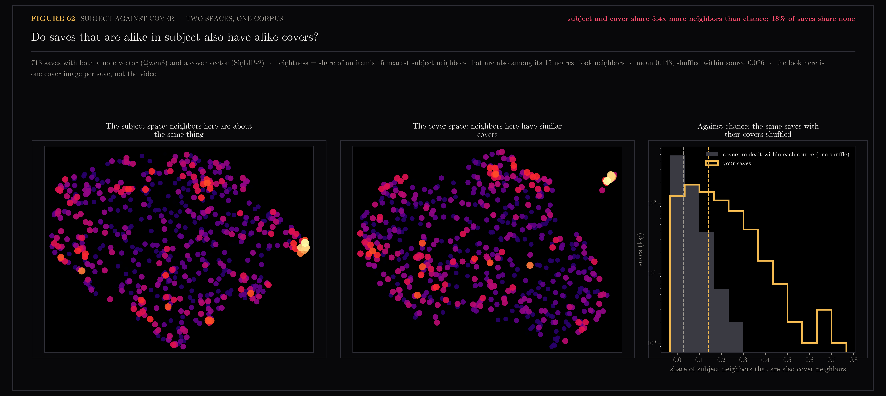

# 62 — Subject against cover: two spaces, one corpus

Drawn 2026-11-22 as the first picture of the taste-library rework: before
any design, see whether the saves that sit together by subject also sit
together by look. Nothing was registered beforehand; this is a look, not a
test.

Generated by `scripts/two_spaces.py`. Read-only on Chroma, no model calls.

```bash
uv run --with matplotlib python scripts/two_spaces.py   # under a minute
```



**What was measured.** 713 of the 721 saves in the visual index also have a
note vector (428 YouTube, 263 Instagram, 17 TikTok, 5 Pinterest). Each save
has a subject vector (Qwen3 over the note's thesis and summary) and a cover
vector (SigLIP-2 over one image: the YouTube thumbnail, the first slide of a
carousel, or a reel's cover). For every save, the share of its 15 nearest
subject neighbors that are also among its 15 nearest cover neighbors.

**The null.** Covers re-dealt among saves of the same source, 200 times, so
the difference between a thumbnail and a reel frame cannot produce agreement
on its own.

| quantity | value |
|---|---|
| shared neighbors, observed | 0.143 |
| shared neighbors, covers shuffled within source | 0.026 ± 0.002 |
| shared neighbors, covers shuffled across everything | 0.021 |
| saves sharing no neighbor | 17.8% |
| cover neighbors from the same source | 0.80 (chance 0.50) |
| subject neighbors from the same source | 0.66 (chance 0.50) |
| YouTube only, observed | 0.180 (chance 0.035) |
| YouTube only, same-creator neighbors dropped | 0.163 |

**What it shows.** The two spaces agree about five times more than chance
and still disagree on 86% of neighbors. One tight island carries the highest
agreement (fight study videos, 0.60 to 0.73); the rest is scattered warm
spots. The agreement is not one channel reusing a thumbnail template: with
same-creator neighbors dropped it moves from 0.180 to 0.163.

**Why it does not answer the question it was drawn for.** The owner's
reading, the same day: a cover is not the look of the thing. A YouTube
thumbnail is designed to sell the video, and a fight video's thumbnail can
be a fighter on a blank ground. Two consequences:

- The cover space measures thumbnails. Whatever the video looks like across
  its length is not in it.
- SigLIP-2 is trained to match images to captions, so its vector carries
  what is depicted. The fight island may be the model recognizing "a
  fighter", which is subject read from pixels, not a shared look. This
  figure cannot tell the two apart.

Also in the figure and not a finding: the cover space sorts by source (0.80
same-source neighbors), which is the medium's framing, not taste.

> **Later:** section 63 rebuilt the look from sprite tiles of the footage. Cover and
> footage agree on 0.198 of neighbors, so the objection above holds as a measurement, and
> pixel statistics of the footage are the one look space close to independent of subject
> (0.085 against 0.035 by chance).

**Standing.** The shape of the comparison stands (two spaces, the same
items, a shuffled null inside each source). The look half has to be rebuilt
from frames of the content itself before the picture says anything about
taste.

`results.json` holds the numbers, the per-save overlap and both layouts; no
ids, titles or URLs.
