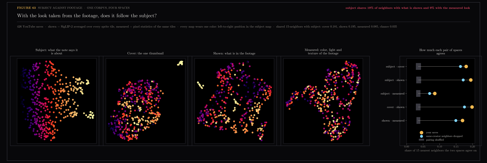

# 63 — Subject against footage: the look taken from the video itself

Drawn 2026-11-22, the same day as section 62 and in answer to the
objection recorded there: a cover is an advertisement, not the look. Here
the look comes from YouTube's sprite grids, the footage itself at one tile
every 1 to 10 seconds. Nothing was registered beforehand.

```bash
uv run python scripts/sprite_sweep.py        # 17 min, network; sprites only, no captions, no video
uv run python scripts/sprite_looks.py        # 5 min, no model
python sprite_embed_cuda.py sprites emb      # on the CUDA machine: 47 min at 34 tiles/s on an RTX 3070
uv run --with matplotlib python scripts/three_spaces.py
uv run --with matplotlib python scripts/look_neighbors_sheet.py <title words>...   # eye check, written outside the repo
```



**What was measured.** 426 of the 428 YouTube saves offered sprites (one
video is gone, one is age-gated): 95,852 tiles, median 152 per video. Each
save gets four vectors:

- **subject**: Qwen3 over the note's thesis and summary, as in 62
- **cover**: SigLIP-2 over the thumbnail, as in 62
- **shown**: SigLIP-2 (same checkpoint and revision) over every tile,
  averaged per video
- **measured**: pixel statistics of the same tiles, no model: brightness,
  contrast, saturation, colorfulness, edge density, dark and bright share
  (mean and spread across the video), a hue histogram, a brightness
  histogram, and how much consecutive tiles differ

For each pair of spaces, the share of a save's 15 nearest neighbors the two
agree on, against the pairing shuffled 200 times, and again with
same-creator neighbors removed. Every map in the figure wears one color,
the save's left-to-right position in the subject map, so a ramp that
survives in another panel is structure the two spaces share.

| pair | shared neighbors | same-creator dropped | shuffled |
|---|---|---|---|
| subject · cover | 0.181 | 0.163 | 0.035 |
| subject · shown | 0.195 | 0.172 | 0.036 |
| subject · measured | 0.085 | 0.070 | 0.035 |
| cover · shown | 0.198 | 0.175 | 0.036 |
| shown · measured | 0.169 | 0.149 | 0.035 |

**What it shows.**

- The cover and the footage agree on one neighbor in five. The objection
  in 62 holds as a measurement: the thumbnail is a different object from
  the video it sells.
- What the image model sees in the footage follows the subject about as
  much as the cover did (0.195 against 0.181). It reads what is depicted,
  so it is partly the subject again, taken from pixels.
- The measured look is close to independent of the subject (0.085 against
  0.035 by chance). It is the one space here that is not the subject in
  another form.

**The eye check.** Four seeds with their nearest saves by measured look and
by what is shown, ten tiles each (the sheet holds saved videos' frames and
titles and stays outside the repo). A fight study's nearest by what is shown
are three more fights; its nearest by measured look are one fight and two
people talking in front of a crowded, brightly lit wall. A math animation
on black finds other white-on-black diagram videos either way. A node-editor
tutorial's nearest by measured look are dark code-editor screencasts; by
what is shown, other node editors. So the measured space sorts by the kind
of screen (dark interface, white on black, bright busy live footage). It
has not been shown to carry anything finer than that.

**Limits.**

- Per-video averages. A video that changes look halfway is one blurred
  point; the tile vectors are kept so this can be undone.
- The tile count is derived from duration, so a video's last tile or two
  can be black padding, and those are in both the average and the
  statistics.
- The measured columns are a first guess, standardized and weighted
  equally except the hue histogram. No column has been tested for whether
  it separates looks the owner cares about.
- YouTube only. Reels and carousels have no sprites.
- The tile vectors were computed on a second machine; five tiles re-embedded
  on the first agree at cosine 1.000.

`results.json` holds the pair scores, their nulls and the four layouts; no
ids, titles or URLs. The tiles, tile vectors and statistics live under
`~/.ytk/sprites` and `~/.ytk/sprites-emb`.
