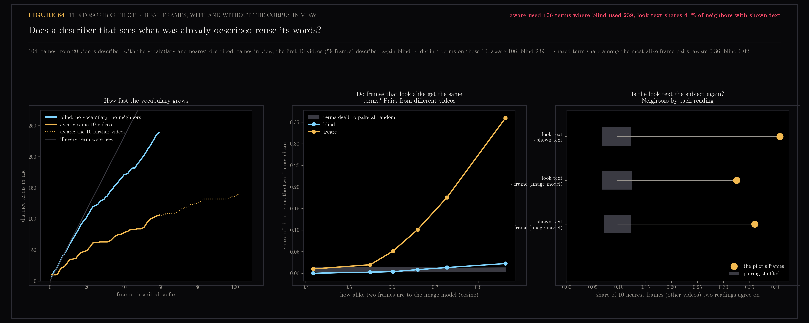
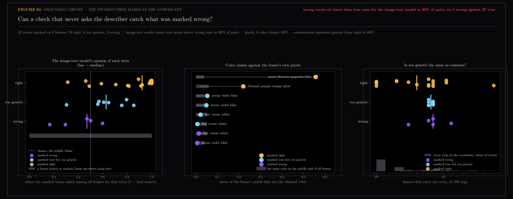

# 64 — Moments, and a describer that sees the corpus

Drawn 2026-11-22. Section 63 left every video as one averaged point and the
measured look sorting only by kind of screen. Two steps here: cut each video
into its distinct looks with no model, then have a model describe real frames
of those looks, with and without the corpus in view. A pilot, 20 videos;
nothing was registered beforehand.

```bash
uv run python scripts/sprite_moments.py                       # 3 min, no model
uv run --with matplotlib python scripts/moments_figure.py
uv run python scripts/look_describer.py                       # 41 min: 111 frames pulled in 3.4 min, then 30 model calls
uv run --with matplotlib python scripts/describer_figure.py   # embeds 208 short texts locally
```

## 64.1 — Moments


**What was measured.** The 95,852 tile vectors of section 63. Near-black
tiles are dropped by rule (mean brightness under 0.03 and spread under 0.02:
495 tiles). Within a video, tiles within cosine distance 0.22 of each other
(average link) are one **look**; an unbroken run of one look is a **moment**.

| | |
|---|---|
| looks | 8,585 |
| moments | 19,968 |
| looks per video | median 13, quartiles 6 and 26, largest 375 |
| videos holding a single look | 30 |

The threshold 0.22 is a first choice and was not tuned against anything. A
fight film study comes out as one look for its whole length.

## 64.2 — The describer pilot



**The setup.** 20 videos: three families of near neighbors by what is shown
(fights, math animations, node-editor tutorials) and seven spread across the
corpus. For each video, one real frame per look for its nine largest looks,
pulled from the video at full resolution at that moment and handed to the
model untouched (111 frames; one fell back to a sprite tile). The model
(`claude-sonnet-5`, through the subscription) never sees a title. Per frame
it writes what is shown, how it looks with the subject removed, a named
lineage if there is one, a feel, and terms as `facet:term`.

- **Aware arm, 20 videos**: the vocabulary built so far with definitions and
  counts, plus, per frame, how its nearest already-described frames (tile
  vector cosine at least 0.70) were worded. Reuse a term when it fits; define
  any new one.
- **Blind arm, the first 10 of those videos**: the same frames, neither.

An earlier run on enlarged sprite tiles was stopped after six videos: the
describer was writing "video compression softness" about the enlargement.

**What came back.** 104 usable frames of 111; the model marked 7 as carrying
no look. 93 of the 104 name a lineage.

| on the same 10 videos, 59 frames | aware | blind |
|---|---|---|
| distinct terms | 106 | 239 |
| terms per frame | 5.3 | 5.8 |
| shared-term share, all pairs from different videos | 0.119 | 0.008 |
| shared-term share, the most alike sixth of pairs | 0.360 | 0.022 |
| distinct style terms | 4 | 36 |

Blind, nearly every term is new: two frames the image model finds most alike
share 2% of their terms, which is inside what dealing terms at random gives.
Aware, they share 36%, and agreement rises with how alike the frames are.
The owner's prediction, that the same thing would be worded differently
each time, is what the blind arm shows.

**Is the look text the subject again?** Neighbors among frames of other
videos, k = 10, 104 frames: the look text and the shown text agree on 0.408
of neighbors (shuffled 0.097), look text and the image model's frame vector
on 0.325, shown text and the frame vector on 0.360. So the look text follows
what is depicted about as much as anything here does. The pilot cannot say
how much of that is leakage, because its three families are frames that
both show the same thing and look the same.

**Limits.**

- Agreement is not correctness. The aware describer was shown its neighbors'
  terms, so it can also carry a wrong term forward. Nothing here scores a
  term against a human judgment.
- Reuse may cost specificity: the aware arm coined 4 style terms where the
  blind arm coined 36. Whether the 4 are the right merge or a collapse is
  not measured.
- Half the vocabulary is single-use (71 of 140 terms), and subject words
  still enter as look terms (a cage-fence backdrop, a forest green).
- One frame per look, nine looks per video, 20 videos, one run per arm. The
  arms ran in sequence on the same frames; no repeat to size run-to-run
  variation.

## 64.3 — The owner's first marks, and three checks scored against them



```bash
uv run --with matplotlib python scripts/grounding_checks.py   # under a minute, no model calls
```

**The marks.** The owner judged 12 of the 104 frames on a review page. On 6
of them he marked individual terms: 32 terms, 19 right, 8 true but too
generic, 5 wrong.

**One false description, verified.** A UFC broadcast frame carried "arena
violet blue", "flat venue white" and a ring-spotlight term, in the prose as
well as the terms, worded as on the neighboring fight frames from another
promotion. Opened, the frame has a dark crowd, a gray canvas and a green
sponsor logo, and no violet. The aware describer had been shown how its
nearest described frames were worded, and nearest was by tile vector, which
section 63 showed is what is depicted. A look was copied across frames that
share a subject.

**Three checks that never ask the describer**, each scored as the share of
pairs it orders correctly:

| check | against the marks |
|---|---|
| image-text model: the term's definition as SigLIP-2 text, and where the marked frame ranks among all 103 frames for it | true above wrong in 90% of pairs (27 true, 5 wrong); median rank 0.92 for right, 0.63 for too generic, 0.47 for wrong |
| pixels: share of the frame in the claimed color family, 8 marked color claims | 83% of pairs; violet-blue is 5.3% and 4.8% of the frame where marked true and 0.6% where marked wrong (0.2% in the median frame); "white" does not separate (0.7% and 2.2% true, 1.4% wrong) |
| commonness: how many frames carry the term | too generic above right in 68% of pairs (medians 6.5 and 4 frames); the wrong terms are the most common of all (median 7) |

**What it shows.** A second model that only compares the term with the
frame already disagrees with most of what was marked wrong. Pixels settle a
chromatic claim and not a claim about white. "Too generic" is not the same
as "common": counting does little, and the terms marked wrong are the ones
reused most, which fits copying.

**Limits.** Six frames carry term marks and the five wrong terms come from
two frames, so every number here is a lead. The color families are hand-set
hue ranges. The page's taste question was read by the owner as something
else, and that field is not used anywhere.

`checks.json` holds the scores; the marks themselves stay outside the repo.

`results.json` holds the counts and the agreement scores. The frames, the
descriptions and the vocabulary live under `~/.ytk/describer`; the sheet of
frames beside their descriptions is written outside the repo.
