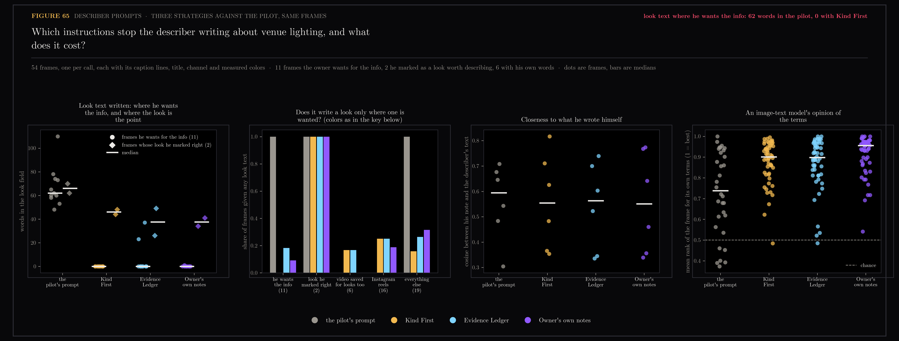

# 65 — Three describer prompts against the pilot's, on the same frames

Drawn 2026-11-22. The owner's reading of the pilot (section 64): it is "very
focused on the lighting configuration of the venue", and his videos are
mainly about content, sometimes content and looks, sometimes content, looks
and vibe. This section tests three system prompts written to that brief.
Nothing was registered beforehand.

```bash
uv run python scripts/describer_ab.py extras     # frames and caption lines for one more video and eight reels
uv run python scripts/describer_ab.py packets    # the evidence for each of the 54 frames, no model
uv run python scripts/describer_ab.py run        # 162 model calls, four at a time, about 30 min
uv run --with matplotlib python scripts/describer_ab_score.py
```



**How the prompts were made.** Four designers each wrote a full prompt from
a different angle, three critics attacked all four (invention, padding,
coverage: 48 problems), and one editor returned three that stay different in
strategy. The fourth was dropped: with its problems fixed it was a shorter
copy of the others.

| prompt | what it bets on |
|---|---|
| Kind First | decide the kind of moment, then a per-kind rule for what is worth writing; a made image always gets a look |
| Evidence Ledger | sort what each evidence source supports before writing; every sentence traces to a source |
| Owner's Own Notes | the owner's own frame notes as the model; one look test, "made to be looked at" |

The prompts themselves quote the owner's notes and stay outside the repo.

**The setup.** 54 frames, one frame per call (`claude-sonnet-5`), each with
only its own evidence: the full-resolution frame, the caption lines before,
at and after the moment, the title and channel, how much of the video the
look fills, and colors measured from the pixels. No other frame's
description. The frames: the 32 of the pilot the owner judged or had not
reached, 6 looks of a video essay he said he saved for content, execution
and looks at once, and 16 frames of 8 Instagram reels. The pilot's own
output on its 32 frames is the comparison.

| | pilot | Kind First | Evidence Ledger | Owner's Own Notes |
|---|---|---|---|---|
| look words where he wants the info (11 frames, median) | 62 | 0 | 0 | 0 |
| frames given any look text, where he wants the info | 100% | 0% | 18% | 9% |
| same, the 2 frames whose look he marked right | 100% | 100% | 100% | 100% |
| terms about light or palette | 42% | 2% | 4% | 2% |
| names per fight frame | 0 | 3.8 | 2.9 | 3.0 |
| names taken from text and found in that text | | 19 of 20 | 15 of 17 | 11 of 11 |
| fight frames saying it cannot tell which fighter is which | | 8 of 13 | 6 of 13 | 5 of 13 |
| image-text rank of its terms (1 = best, 0.5 = chance) | 0.73 | 0.88 | 0.87 | 0.91 |
| closeness to the owner's own notes (6 frames) | 0.56 | 0.56 | 0.54 | 0.56 |

**What it shows.**

- All three stop the lighting. Given the transcript, the title and a rule
  that an empty look is a good answer, the look field goes from 62 words to
  none on the frames he wants for the info, and stays filled on the two
  whose look he marked right.
- They read the frame. Fighter names, rank and champion marks come off the
  scorebug with their source stated.
- One check against the owner's own note separates them. On the one frame
  where he wrote which fighter stands where, Kind First said it could not
  tie a name to a side; the other two assigned the names, and assigned them
  the wrong way round.
- A look is written on made images (a video-synth texture, a toon render, a
  tilted web-page graphic) and withheld on people talking.
- Closeness to his own notes does not move. That measure cannot tell these
  prompts apart.

**What it does not show.** The video he saved for its looks is 43% one
person talking to a camera, and every prompt left that frame's look empty.
What he called execution and looks is a property of the whole video: how it
is cut and what it moves between. A note about one frame cannot hold it.

**Limits.** One run per prompt. The side-assignment check is one frame.
The eight reels are the ones whose video was already on disk, not ones
chosen for their look. No human has compared the three outputs side by
side.

`results.json` holds the scores. Outputs are under `~/.ytk/describer/ab`.
