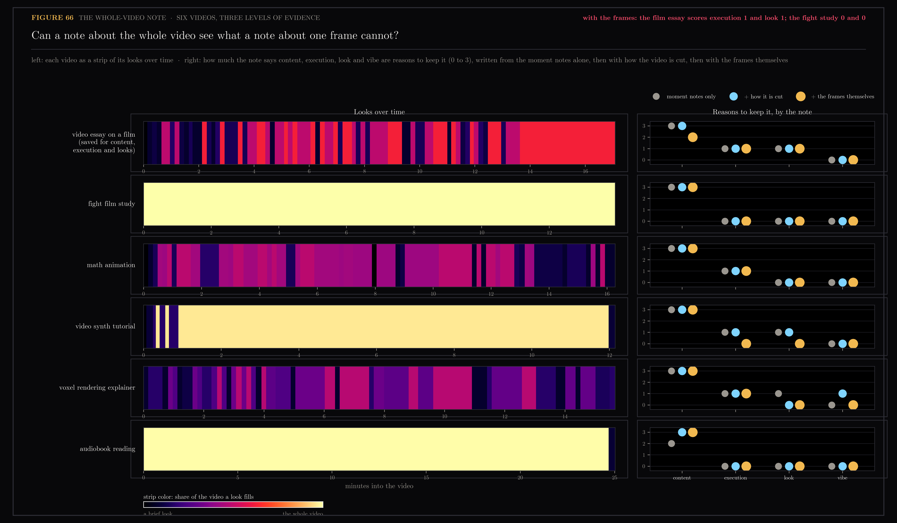

# 66 — A note about the whole video

Drawn 2026-11-22. Section 65 ended on a gap: a video the owner saved for
content, execution and looks at once is mostly one person talking, so no
note about a single frame can say why. This section composes one note per
video from the notes on its moments and asks whether that note sees it.
Nothing was registered beforehand.

```bash
uv run python scripts/video_note.py moments    # Kind First on each look not yet described, 13 calls
uv run python scripts/video_note.py compose    # 6 videos x 3 levels of evidence, 18 calls
uv run --with matplotlib python scripts/video_note_figure.py
```



**The setup.** Six videos: the film essay, and five chosen as contrasts (a
fight film study that is one look for 14 minutes, a math animation, a video
synth tutorial, a voxel rendering explainer, an audiobook reading). Each
distinct look with a real frame on disk gets a Kind First moment note
(section 65). One call then writes the video note: what it is, how it is
made, its look, where the look comes from, its vibe, and 0 to 3 for content,
execution, look and vibe as reasons to keep it. Three levels of evidence:

| level | what the composer is given |
|---|---|
| notes | the moment notes, the stored summary, the title |
| structure | plus how it is cut: looks, shares, changes of look per minute, the order looks appear in |
| frames | plus the frames themselves, untouched |

**What came back** (content, execution, look, vibe):

| video | notes | structure | frames |
|---|---|---|---|
| film essay, saved for content, execution and looks | 3 1 1 0 | 3 1 1 0 | 2 1 1 0 |
| fight film study | 3 0 0 0 | 3 0 0 0 | 3 0 0 0 |
| math animation | 3 1 0 0 | 3 1 0 0 | 3 1 0 0 |
| video synth tutorial | 3 1 1 0 | 3 1 1 0 | 3 0 0 0 |
| voxel rendering explainer | 3 1 1 0 | 3 1 0 1 | 3 1 0 0 |
| audiobook reading | 2 0 0 0 | 3 0 0 0 | 3 0 0 0 |

**What it shows.**

- The description of how a video is made is accurate and specific. For the
  film essay: a host on camera with a handheld microphone for about half
  the running time, cut against film clips and stills, one split-screen
  shot comparison, and a web page staged as a tilted graphic with cutout
  portraits. The single-look videos get an empty "made".
- The judgment the owner made is not recovered. He called the film essay
  right in content, execution and looks; the note scores execution 1 and
  look 1, the same as a math animation and a software tutorial. More
  evidence did not move it: the scores are the same at all three levels.
- More evidence can lower a score. Shown the frames, the composer dropped
  the video synth tutorial's look from 1 to 0, calling a node editor
  ordinary, though the video's output is a made image.

**Reading.** The note can say how a video is built. It cannot say that the
building is good, and stills with cut counts hold little of what execution
is: writing, timing, what is cut on which word. Whether a video is well made
by the owner's standard is his call. The usable design is the other way
round: the describer writes how it is made, the owner says which ones he
rates, and "made" becomes the thing his rating is compared across.

**Limits.** One video carries the owner's statement, so the miss is one
case. Each video is seen through at most nine frames, and the film essay
through six of its twenty looks. Changes of look are counted from a frame
every 5 to 10 seconds, so fast cutting is undercounted. One moment call
failed and that look is missing from the math animation's note. One run per
level.

`results.json` holds the scores. The notes are under `~/.ytk/describer/video`.
