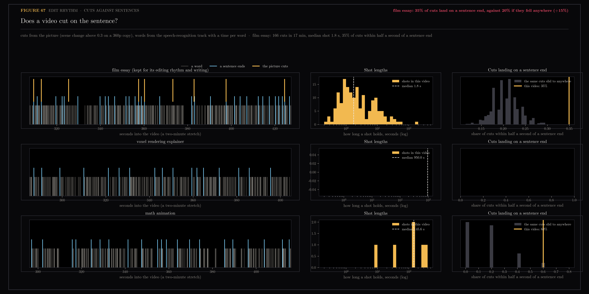

# 67 — Edit rhythm: where the picture cuts, against where the sentences end

Drawn 2026-11-22. Section 66 could describe how a film essay is built and
not why the owner rates it. Asked what made it right, he said the editing
rhythm and the writing. Neither is in a still. This is a first look at both
at once, from the two streams that carry them. Nothing was registered.

```bash
uv run python scripts/edit_rhythm.py fetch                    # a 360p copy per video, cuts, word-timed captions; the copy is deleted
uv run --with matplotlib python scripts/edit_rhythm.py plot
```



**What was measured.** Cuts: ffmpeg's scene-change score above 0.30 on a
360p copy of the picture. Words: YouTube's speech-recognition track, which
carries a time per word; a sentence ends at a word with closing punctuation.
For each cut, the distance to the nearest sentence end. The null slides the
same cuts along the video by a random amount, 500 times, so the spacing of
cuts and of sentences is kept and only their alignment is broken.

| | film essay | voxel explainer | math animation |
|---|---|---|---|
| cuts | 166 in 17.1 min | 0 | 5 |
| median shot | 1.8 s | none | 146 s |
| words per minute | 169 | 156 | 135 |
| median sentence | 4.0 s | 6.5 s | 5.6 s |
| cuts within 0.5 s of a sentence end | 35% | | 3 of 5 |
| the same with cuts slid anywhere | 20% (99th percentile 28%) | | |

**What it shows.**

- The essay cuts on the sentence more than chance: 35% of its cuts fall
  within half a second of a sentence end, against 20% when the same cuts
  are slid anywhere, and above every one of the 500 slides.
- It is a cut video in a way the other two are not. Section 64 counted 3.6
  changes of look a minute from a frame every ten seconds; the picture
  itself has 9.7 cuts a minute and a median shot under two seconds. The
  cuts come in bursts: a two-minute stretch can hold nine.
- Its sentences are shorter and faster than the two explainers'.

**What it does not show.**

- That this is why he rates it. One video, and no video with as many cuts
  that he does not rate. The two contrasts barely cut at all, so the only
  comparison is against the essay's own shuffled cuts.
- Whose cuts they are. The essay shows film clips, and a clip's own cuts
  are counted with the essayist's.
- Anything about the writing beyond when sentences end.

**Limits.** Scene change at one threshold, on a small copy; fades and
graphics that move can be missed or counted. Word times come from speech
recognition. Half a second is a chosen window.

`results.json` holds the numbers. Cuts and word times are under
`~/.ytk/describer/rhythm`.
