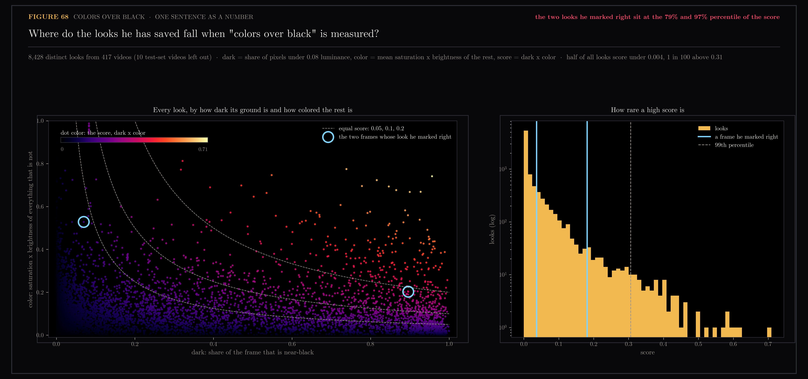
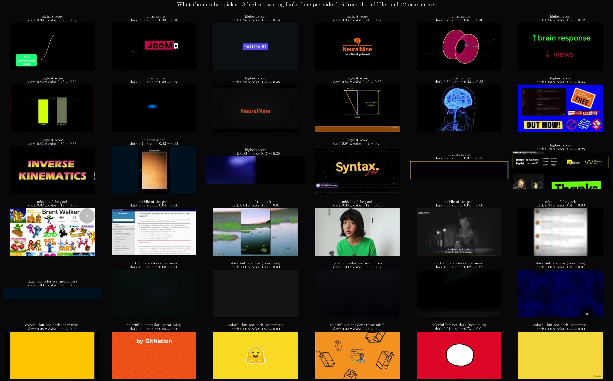

# 68 — "Colors over black" as a number

Drawn 2026-11-22. The owner, describing a look he loves: "colors over
black". This writes the sentence as a measurement and scores every distinct
look in the corpus with it, as the first step of the taste experiment: an
instrument for finding frames to ask him about, not a proposed style space.
Nothing was registered.

```bash
uv run --with matplotlib python scripts/colors_over_black.py   # about 8 min the first time, no model
```



**The measurement.** Per look, on its representative sprite tile:
`dark` is the share of pixels under 0.08 luminance, `color` is the mean of
saturation times brightness over the pixels that are not, and the score is
their product. 8,428 looks from 417 videos; the ten videos of the taste
test set are left out so that set stays unseen.

| | |
|---|---|
| median score | 0.004 |
| 90th percentile | 0.082 |
| 99th percentile | 0.31 |
| looks scoring above 0.1 | 7.6% |
| the two looks he marked right on the review page | 79th and 97th percentile |

**What it shows.**

- A high score is rare. Most of what he saves is not dark, or is dark and
  gray.
- The number finds the wrong thing first. Of the 18 highest-scoring looks,
  one per video, most are a logo, a title or a line of colored text on a
  black card. A few are what he means: a pink torus, a glowing blue brain,
  a curve on black. A small colored mark on a large black field maximizes
  dark times color, whatever the mark is.
- One of the two looks he marked right is not over black at all. The video
  synth texture fills the frame with color (dark 0.07) and sits at the 79th
  percentile; the glowing render (dark 0.90) sits at the 97th. "Colors over
  black" names one look he likes, not the look he likes.

**Reading.** The sentence leaves out what the frames show it needs: how much
of the frame the colored thing fills, and whether it is a shape or type.
That is composition, which a whole-frame statistic cannot see. The high
scorers are still the right frames to put in front of him, since his no on
a logo card is as informative as his yes on a render.

**Limits.** One tile per look, at sprite size. Two labeled frames. The
thresholds are chosen, not fitted.

`results.json` holds the numbers. What the number picks, the 18 highest-scoring looks, 6 from the middle and
12 near misses:


