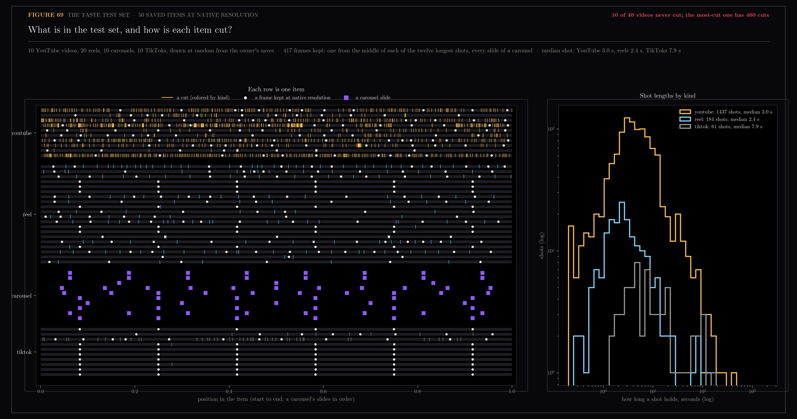

# 69 — The taste test set

Drawn 2026-11-22. The owner asked for a fresh sample of his saves, on disk
at native resolution, to dissect: 10 YouTube videos, 20 reels, 10 carousels,
10 TikToks. This section is the set itself and what was read from it; the
comparisons that use it follow in later sections.

```bash
uv run python scripts/taste_test.py download      # 50 items, 22 min; Instagram through the browser's cookie session
uv run python scripts/taste_dissect.py frames     # cuts from the picture, frames at each file's own size
python taste_embed_cuda.py flat order.json out.npz   # on the CUDA machine, 33 s for 417 frames
uv run --with matplotlib python scripts/taste_features.py
```



**The draw.** Seeded random samples from 457 saved YouTube videos, 213
reels, 59 carousels and 21 TikToks. The titles were read for spread before
anything was downloaded and five were swapped, each for another random draw:
two of four AI and developer-tool videos (for a fight video and a
procedural-graphics video, drawn from those tags), and three notes that
recorded a failed capture. All 50 downloaded; none was missed.

| kind | items | as served | frames kept |
|---|---|---|---|
| YouTube | 10 | native, three in 2160p; 2.9 GB | 116 |
| reels | 20 | 720 x 1280 for 18 | 162 |
| carousels | 10 | 3 to 20 slides | 71 |
| TikToks | 10 | 1080 x 1920 for 7 | 68 |

**How it was cut.** Cuts are scene changes above 0.30 on a small decode of
the picture. A video gives one frame from the middle of each of its twelve
longest shots, saved at the file's own size; a video that never cuts gives
six evenly spaced; a carousel gives every slide.

- 10 of the 40 videos never cut. The most-cut one has 460 cuts.
- Median shot: 3.0 s for the YouTube videos, 2.4 s for reels, 7.9 s for
  TikToks.

**What was read from each of the 417 frames.**

- Pixels: light, contrast, saturation, colorfulness, edges, dark and bright
  share, hue and light histograms.
- Where: light, saturation, edges and colored share per cell of a 4 x 4
  grid.
- The colored region: coverage, how spread it is on 2, 4 and 8 cell grids,
  how many pieces, how much of it is thin stroke, how aligned its edges are,
  where its center sits.
- SigLIP-2, same checkpoint as the corpus: the pooled vector, and at three
  depths of the vision tower the per-channel mean and spread of the patch
  features and a Gram matrix of the patches after a fixed projection to 64
  channels.

> **Later:** sections 70 to 72 each compared families on these 50 items, so the set is
> development data. A held-out set has to be drawn before any reading is tested on the
> owner's judgments beyond a pilot.

**Limits.** The set is drawn from the same saves as everything else, so it
is unseen, not independent; one YouTube video in it was also in the
describer pilot. Instagram served reels at 720p. Pixel readings are taken at
768 px on the long side. Readable text is not measured yet.

`results.json` holds the counts. Files, frames and features are under
`~/.ytk/taste-test`.
