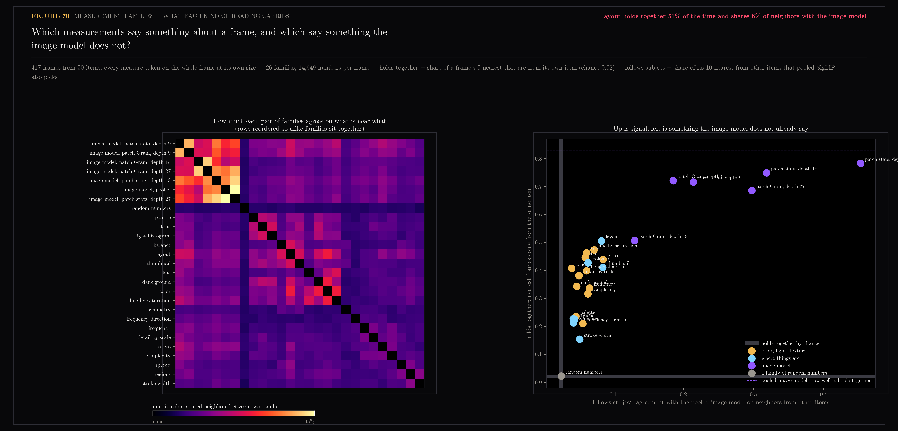

# 70 — Which families of measurement carry anything

Drawn 2026-11-22. Section 69 read a handful of chosen numbers from each test
frame, at 768 px. The owner's objection: why not the whole image, and why
only those. This section reads every frame whole, at its own size, with a
wide bank of measurements, and asks of each family whether it says anything
and whether it says anything new. Nothing was registered.

```bash
python taste_bank_cuda.py flat order.json bank.npz           # on the CUDA machine, 2 min 44 s for 417 frames
uv run --with matplotlib python scripts/taste_families.py
```



**The bank.** 19 families, 347 numbers per frame, each taken over the full
frame as served (up to 3840 x 2160) and expressed relative to the frame:
frequencies in cycles per image, widths as fractions of the long side.

| group | families |
|---|---|
| light | tone, light histogram |
| color | color, hue with its harmonics, hue by saturation, a five-color palette, dark ground |
| texture and detail | frequency content, frequency by direction, detail at six scales, edges, complexity |
| where things are | layout on a 4 x 4 grid, thumbnail, balance, symmetry, spread, regions, stroke width at four widths |

With the seven image-model families of section 69 (pooled, and patch
statistics and patch Gram matrices at depths 9, 18 and 27), 26 families.

**Two scores per family**, with a family of random numbers beside them:

- *holds together*: the share of a frame's 5 nearest frames that come from
  its own item. Chance is 0.02.
- *follows subject*: the share of its 10 nearest frames from other items
  that the pooled image model also picks. Random numbers score 0.03.

| family | holds together | follows subject |
|---|---|---|
| image model, pooled | 0.83 | 1 |
| patch statistics, depth 27 | 0.78 | 0.45 |
| patch statistics, depth 18 | 0.75 | 0.32 |
| patch Gram, depth 9 | 0.72 | 0.19 |
| patch statistics, depth 9 | 0.72 | 0.21 |
| layout | 0.51 | 0.08 |
| hue by saturation, color, hue, edges, balance | 0.43 to 0.47 | 0.06 to 0.09 |
| tone, thumbnail, light histogram, detail by scale | 0.38 to 0.41 | 0.04 to 0.09 |
| palette, spread, regions, symmetry, frequency by direction | 0.21 to 0.24 | 0.04 to 0.06 |
| stroke width | 0.15 | 0.05 |
| random numbers | 0.02 | 0.03 |

**What it shows.**

- Every family is far above random numbers on holding together, so none is
  noise. Stroke width, the weakest, is seven times chance.
- Depth separates the image model from its own subject reading. The same
  patches, summarized at depth 9, hold together nearly as well as the
  pooled vector (0.72 against 0.83) while sharing a fifth of its neighbors;
  by depth 27 they share 45%.
- The pixel families barely follow subject at all (0.04 to 0.09, random is
  0.03) and form their own blocks: light with palette, color with hue, the
  layout measures together. They are a different reading from the image
  model, as section 63 found for pixel statistics, and now for 19 kinds.

**What it does not show.** That any of these is style. Frames of one item
share a camera, an encoder, a creator and a format, so a family can hold
together by recognizing the file rather than the look. Frame size and
aspect ratio were measured and are left out here for that reason; with them
the complexity family rose from 0.32 to 0.49. The same shortcut may be
inside others, the early image-model layers included. Only the owner's
triplets across items can tell.

**Limits.** One set of 417 frames. Readable text is not measured. Each
family is compared after standardizing its columns, with equal weight per
number.

`results.json` holds both scores for every family.
