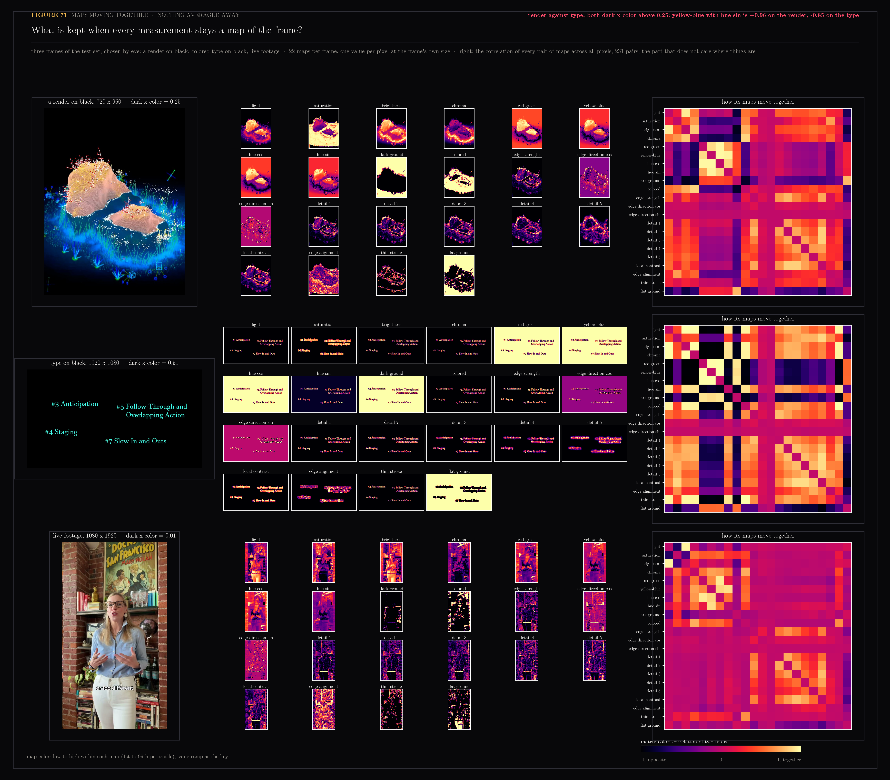
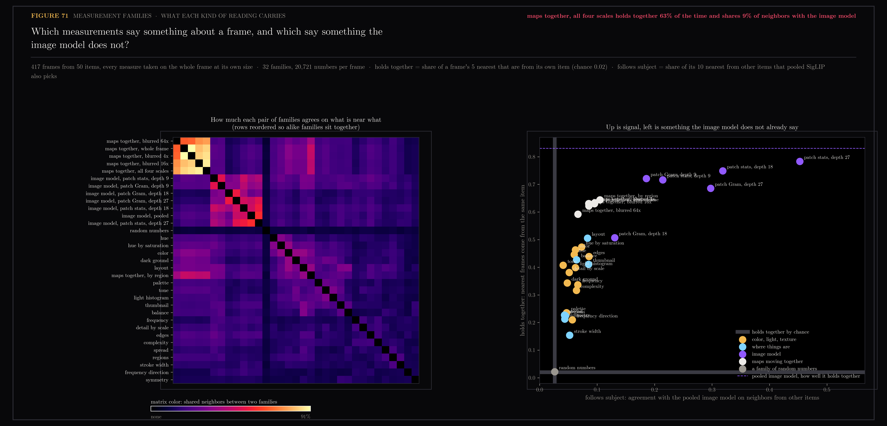

# 71 — Maps moving together: nothing averaged to one number

Drawn 2026-11-22. Section 70 reduced every family to a few numbers per
frame. The owner: "I don't want families averaged. I want all the data." He
had also asked whether the families could be treated like the layers of a
convolution. They are channels, side by side; what a style reading takes
from channels is how they vary together across the frame. This section
keeps every measurement as a map and measures that. Nothing was registered.

```bash
python taste_maps_cuda.py flat order.json maps_out          # on the CUDA machine, 2 min 14 s; writes 42 GB of maps
uv run --with matplotlib python scripts/taste_maps_figure.py
uv run --with matplotlib python scripts/taste_families.py   # the comparison of section 70, with the new families in it
```



**What is kept.** For each of the 417 test frames, at its own size:

- 22 maps, one value per pixel: light, saturation, brightness, chroma, the
  two color-opponent axes, hue as two components, dark ground, colored,
  edge strength and direction, detail at five scales, local contrast, edge
  alignment, thin stroke, flat ground.
- The correlation of every pair of maps across all pixels, 231 pairs, on
  the frame as it is and blurred 4, 16 and 64 times.
- The same correlations inside each cell of a 4 x 4 grid.
- The maps themselves, on disk: 42 GB for the set, on the CUDA machine.

The figure shows three frames chosen by eye, with their maps and matrices:
a luminous render on black, colored type on black, and live footage. The
"dark x color" number of section 68 puts the type (0.51) above the render
(0.25). The matrices tell them apart: averaged over all 231 pairs, the
render's matrix differs from the type's by 0.30, as much as it differs from
the live footage's (0.27). On the type nearly every map moves with every
other, because color, edges and detail all sit on the same strokes. On the
render the color maps and the detail maps form separate blocks, as they do
on live footage.

The figure was redrawn the same day. Its first version took the frame with
the highest "dark x color" score as its example, which is the type card: a
frame picked by the number this section argues is not enough.



**Against the other families**, with the two scores of section 70:

| family | holds together | follows subject |
|---|---|---|
| image model, pooled | 0.83 | 1 |
| image model, patch Gram, depth 9 | 0.72 | 0.19 |
| maps together, by region | 0.64 | 0.10 |
| maps together, whole frame | 0.63 | 0.10 |
| maps together, blurred 64x | 0.59 | 0.07 |
| layout, the best averaged family | 0.51 | 0.08 |
| random numbers | 0.02 | 0.03 |

**What it shows.**

- Keeping the maps and reading how they move together holds a frame with
  its own item 63% of the time, against 51% for the best averaged family
  and 15 to 47% for the rest. What the averages threw away was signal.
- It follows subject about as little as the averaged pixel families (0.10)
  and half as much as the image model's early layers (0.19).
- It is its own reading. In the agreement matrix the five whole-frame
  versions form a block that shares little with either the image model or
  the averaged families; only the by-region version leans toward layout.
- The scale barely matters between 1x and 16x.

**What it does not show.** The caution of section 70 stands: frames of one
item share a file, and holding together is not style. This reading has not
been compared with the owner's judgment of what looks alike.

**Limits.** Correlation is one summary of how two maps relate; it misses
relationships that are not linear and it discards position by design. The
22 maps are a chosen set. One set of frames.

`families.json` holds both scores for every family. The maps are under
`~/ytk-sprites/taste/maps_out` on the CUDA machine; the statistics are in
`~/.ytk/taste-test/together.npz`.

> **Later:** the 42 GB of stored maps was removed. Nothing read them: every
> result here and in section 72 comes from the statistics, and a frame plus
> `taste_maps_cuda.py` gives its maps back exactly. The three per-frame
> scripts are now run by one command that decodes each frame once and keeps
> each frame's readings in a cache keyed by the frame's bytes and the code:
> `python taste_pass_cuda.py <frames> order.json <out> [--one-per-item]`.
> Checked against this section's numbers: the map statistics are identical,
> the bank agrees to 0.0002 (its box average is now taken along rows then
> columns). A first pass over the 417 frames takes 183 s on the 3070; a
> repeat takes 2 s.
