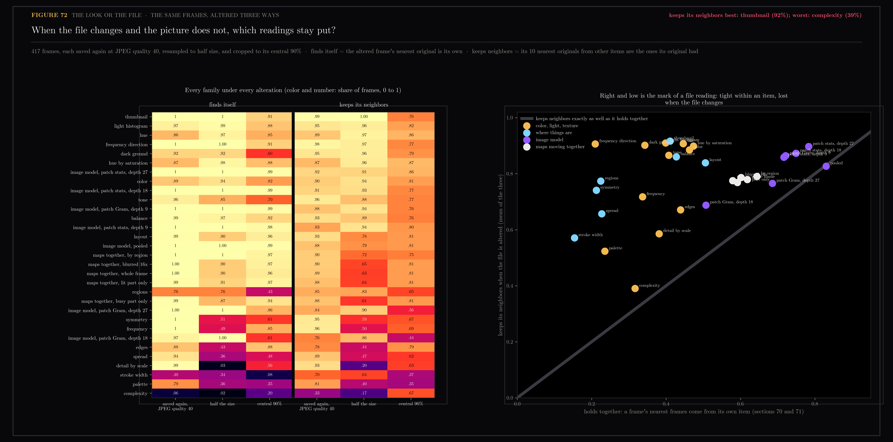
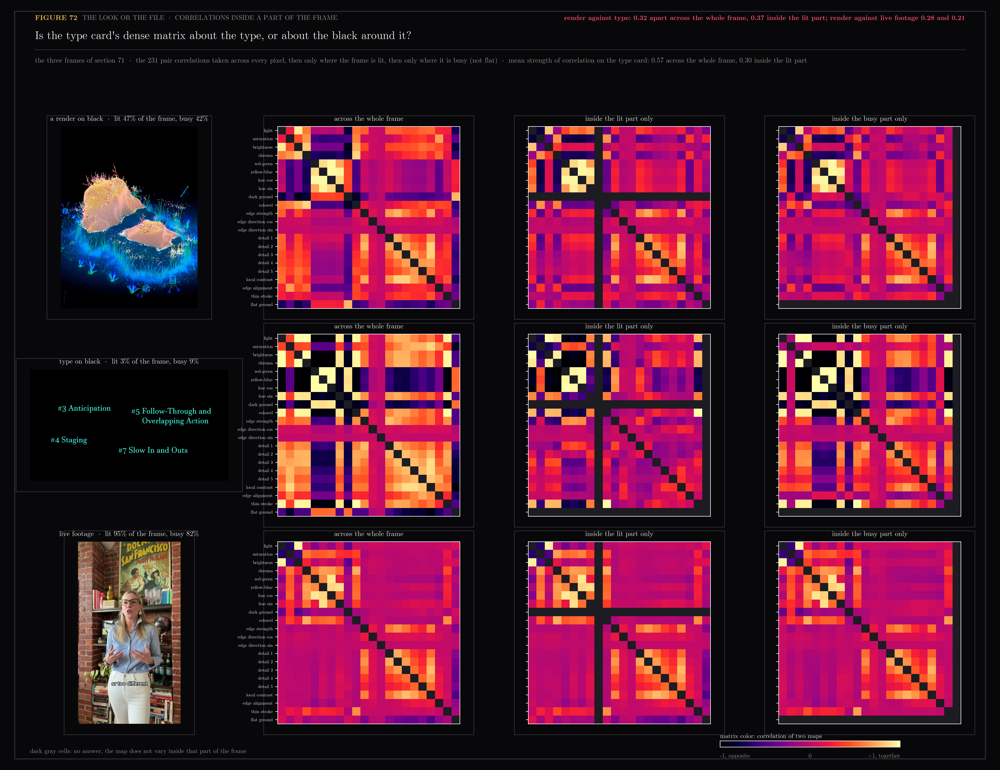
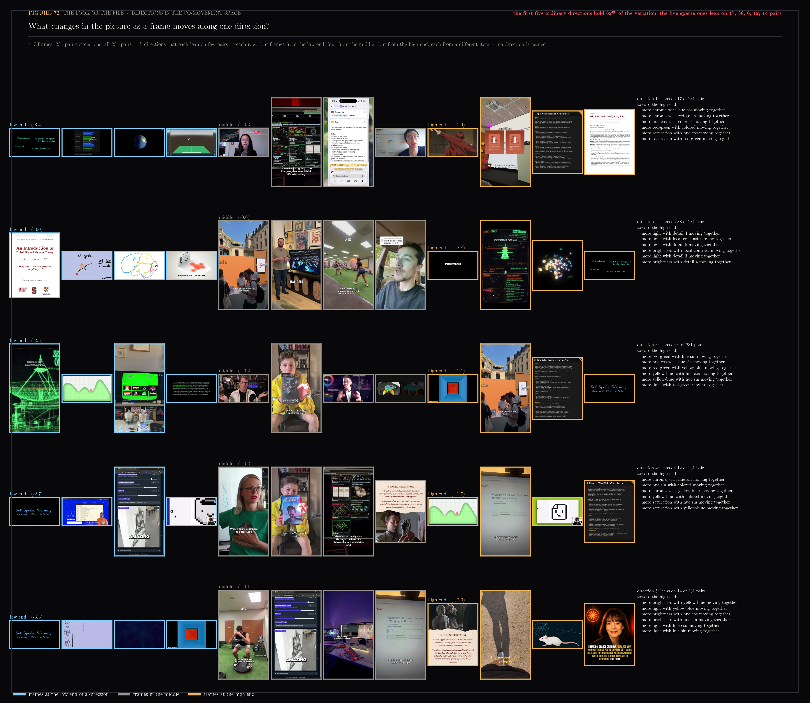
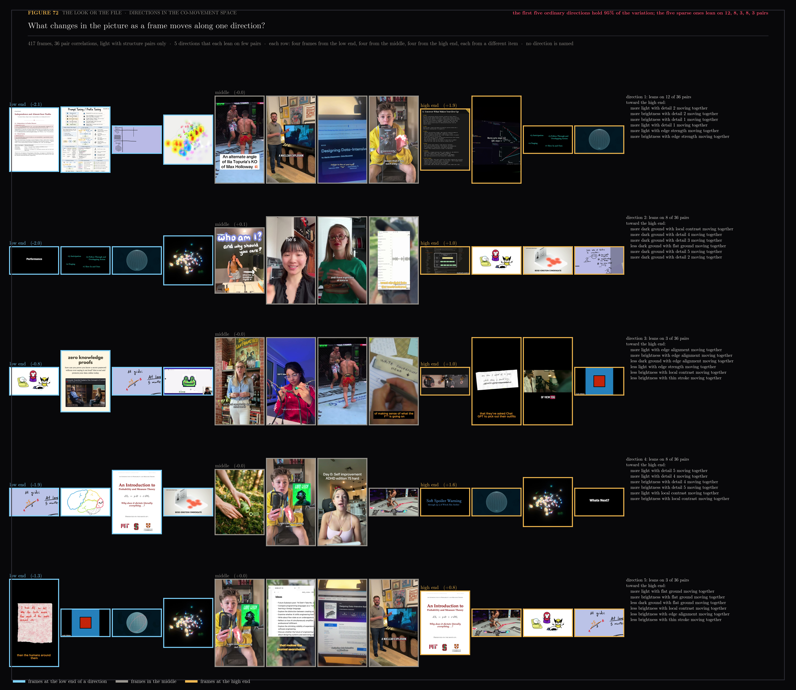
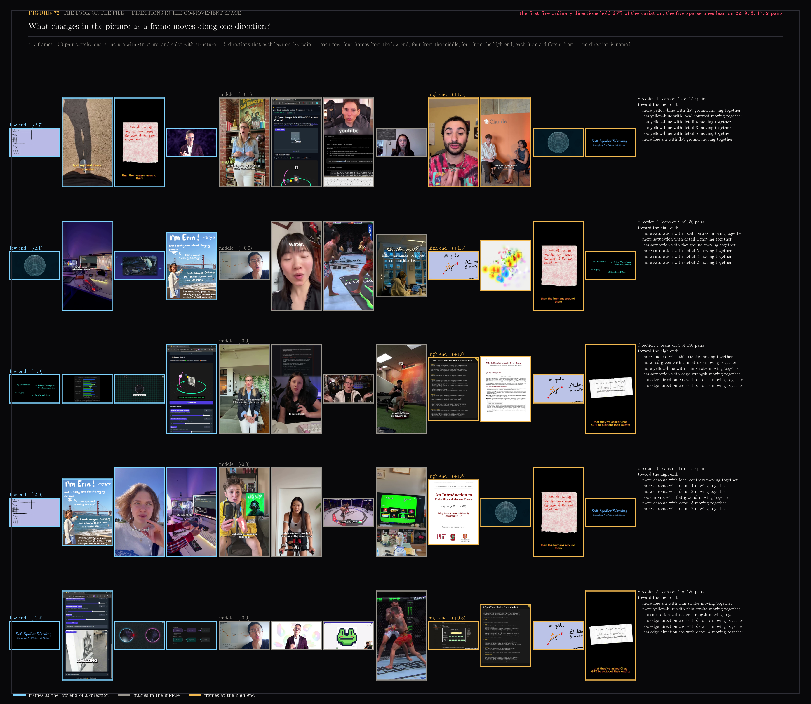

# 72 — The look or the file

Drawn 2026-11-22. Sections 70 and 71 found readings that keep a frame with
its own item, and both ended on the same doubt: frames of one item share a
file, so holding together might be recognizing the file. This section tests
that without labels, then looks inside the co-movement reading. Three parts,
each reported as it landed. Nothing was registered beforehand.

```bash
bash run72.sh                                                 # on the CUDA machine, 11 min 45 s: alters the frames, recomputes every family
uv run --with matplotlib python scripts/taste_invariance.py
uv run --with matplotlib python scripts/taste_conditional_figure.py
for b in all light-structure structure; do uv run --with matplotlib python scripts/taste_directions.py together_scale_1 $b; done
```

`run72.sh` is `taste_perturb.py`, then `taste_maps_cuda.py --no-maps`,
`taste_bank_cuda.py` and `taste_embed_cuda.py` on each altered set.

## 72.1 — The same frames, altered three ways



**What was measured.** Each of the 417 frames saved again as JPEG at
quality 40, resampled to half its width and height, and cropped to its
central 90%. Every family recomputed on the altered frame at its own size.
*Finds itself*: the altered frame's nearest original is its own. *Keeps
neighbors*: its 10 nearest originals from other items are the ones its
original had.

| family | holds together | finds itself | keeps neighbors: saved again / half size / cropped |
|---|---|---|---|
| image model, patch statistics, depth 27 | 0.78 | 1.00 | 0.92 / 0.91 / 0.86 |
| image model, patch Gram, depth 9 | 0.72 | 1.00 | 0.88 / 0.94 / 0.76 |
| image model, pooled | 0.83 | 1.00 | 0.88 / 0.79 / 0.81 |
| layout | 0.51 | 0.95 | 0.93 / 0.78 / 0.81 |
| maps together, whole frame | 0.62 | 0.95 | 0.89 / 0.63 / 0.81 |
| maps together, lit part only | 0.58 | 0.96 | 0.88 / 0.64 / 0.81 |
| frequency | 0.34 | 0.78 | 0.96 / 0.50 / 0.69 |
| edges | 0.44 | 0.73 | 0.78 / 0.44 / 0.79 |
| detail by scale | 0.38 | 0.53 | 0.93 / 0.20 / 0.63 |
| complexity | 0.32 | 0.09 | 0.33 / 0.17 / 0.67 |

- No strong family is an encoder fingerprint. Saved again at quality 40,
  maps-together keeps 0.88 to 0.90 of its neighbors across items and the
  image-model families 0.83 to 0.92.
- One family reads the file: complexity, which holds JPEG bytes per pixel,
  finds itself 9% of the time.
- The weakness is scale. At half size maps-together falls to 0.63, edges to
  0.44, frequency to 0.50, detail-by-scale to 0.20. Section 70 said every
  measure was relative to the frame. For these it was not: the detail
  pyramid starts at two pixels, the gradient is per pixel, and the
  frequency bands run past what a halved 720p frame can hold. They read the
  pixel grid as well as the picture. The image-model families are spared
  because the model resizes every frame to 384 px.

## 72.2 — Correlations inside a part of the frame



On a frame that is mostly black every map marks the same small lit region,
so its whole-frame correlations rise together. Taken only inside the lit
part (luminance at least 0.08) and only inside the busy part (local
contrast at least 0.02), on the three frames of section 71:

| | mean strength, whole frame | inside the lit part | inside the busy part |
|---|---|---|---|
| render on black (47% lit) | 0.34 | 0.26 | 0.24 |
| type on black (3% lit) | 0.57 | 0.30 | 0.43 |
| live footage (95% lit) | 0.18 | 0.19 | 0.18 |

About half of the type card's dense matrix was the black around it. Inside
the lit part the render moves toward the live footage (0.28 apart to 0.21)
and away from the type (0.32 to 0.37). Three frames, chosen by eye. On all
417 frames the lit-only and busy-only readings are no more stable under
alteration than the whole-frame one (0.78 and 0.77 against 0.78): they
change what is measured without making it sturdier.

## 72.3 — Directions





Directions that lean on few pairs (sparse PCA), each shown as real frames
from its low end, middle and high end, one item per frame, beside the pairs
that drive it. None is named.

- Over all 231 pairs, one direction can be read by eye and four cannot.
  The four are relationships among color maps, which is which colors a
  frame has; half the 22 maps are color maps.
- Light with structure, 36 pairs: one axis holds 80% of the block. Its
  heaviest pair, light with fine detail, averages -0.60 over the 20 lowest
  frames and +0.71 over the 20 highest. At one end the bright pixels are
  the smooth ones, ink on a light page; at the other the bright pixels are
  the detailed ones, luminous marks on dark. This is the owner's "colors
  over black", found without being asked for and stated as a relationship.
- That axis does not tell type from geometry. The type card, a wireframe
  on black and the render sit at its 100th, 93rd and 92nd percentiles.
- Where color sits on thin strokes, type and wireframe go together (95th
  and 80th percentile) and the filled render separates (35th). Co-movement
  at a pixel sees colored thin strokes on black as one thing whether the
  strokes are letters or a mesh.

**Standing.** The readings follow the look more than the file, with scale
as the defect to fix. One property has been found and can be said plainly:
whether detail is carried by light or by darkness. Whether the owner sees
it, and whether he values it, has not been asked.

**Limits.** The 50 items have now been used to compare families three
times and are development data, not a test set. Alterations test the file,
not the camera or the creator. The galleries are read by eye, by the
author. Readable text is still unmeasured.

`invariance.json`, `conditional.json` and `directions-*.json` hold the
numbers.
